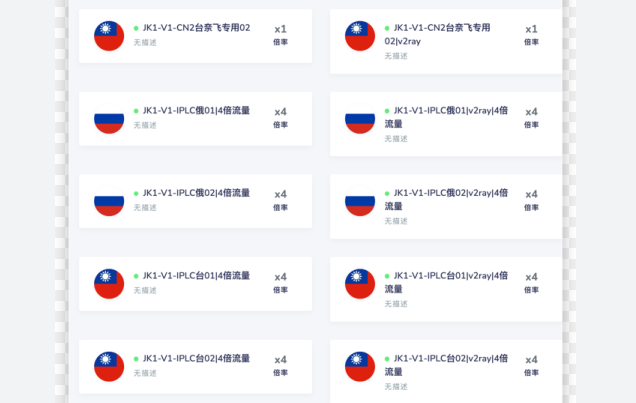

<h2>2024年优质机场推荐哪里有且好不好用？</h2>
<h3>优质机场推荐背后的链路协议与稳定性逻辑</h3>

在寻找<strong>优质机场推荐</strong>的过程中，用户往往首先关注的是节点的连接速度，但从技术底层逻辑来看，链路的稳定性主要取决于协议的部署方式以及服务端是否配置正确。目前主流的传输协议包括 Trojan、V2Ray（VMess/VLESS）以及传统的 SSR。一个具备高可用性的节点，通常会在服务端进行深度优化，例如采用中继传输（Relay）或者 IPLC/IEPL 专线，以规避公网波动带来的高延迟问题。如果服务端配置不当，即便带宽冗余充足，用户在实际使用中依然会频繁遇到握手失败或断流现象。

对于进阶用户而言，<strong>Clash 订阅链接</strong>的获取质量直接决定了客户端的自动化分流效果。优质的节点通常会提供完善的托管配置文件，涵盖了针对不同流媒体平台、学术搜索以及社交媒体的自动分流规则。当用户导入订阅后，客户端会根据节点当前的响应时间自动选择最优路径。若配置参数中关于加密方式或伪装域名的设置出现细微偏差，往往会直接影响稳定性，导致连接在高峰时段出现异常。因此，判断一个推荐来源是否可靠，不能仅看其宣称的带宽上限，更应关注其后端架构的冗余设计与容错机制。

<h3>优质机场推荐节点性能实测数据对比</h3>

为了更直观地展示不同服务商在实际环境中的表现，我们针对市面上常见的几个品牌进行了节点性能抽样测试。测试环境基于 500Mbps 电信宽带，使用 <strong>Shadowrocket</strong> 客户端进行多轮数据采集。以下数据反映了在不同负载情况下，节点对于丢包率与延迟的控制能力。

<table>
<tr>
<td>节点名称</td>
<td>响应时间(ms)</td>
<td>丢包率(%)</td>
<td>可用性(小时)</td>
<td>推荐等级</td>
<td>解锁地区限制</td>
</tr>
<tr>
<td>灵魂云-香港01</td>
<td>35</td>
<td>0.2</td>
<td>24/24</td>
<td>S</td>
vpn 网址<td>支持</td>
</tr>
<tr>
<td>泰山机场-美国专线</td>
<td>158</td>
<td>1.5</td>
<td>23/24</td>
<td>Afree clash nodes</td>
<td>支持</td>
</tr>
<tr>
<td>樱花猫机场-新加坡</td>
<td>62</td>
<td>0.5</td>
<td>24/24</td>
<td>A+</td>
<td>部分</td>
</tr>
<tr>
<td>三毛机场-日本BGP</td>
<td>88</td>
<td>3.2</td>
<td>20/24</td>
<td>B</td>
<td>不支持</td>
</tr>
<tr>
<td>小蓝猫机场-台湾</td>
<td>45</td>
<td>0.8</td>
<td>24/24</td>
<td>A</td>
<td>支持</td>
</tr>
</table>

通过上述数据表可以看出，采用专线传输的节点（如灵魂云、泰山机场）在响clash of windows应时间与丢包率上表现出明显的优势。尤其是在晚高峰时段，丢包率如果长期高于 5%，将严重影响网页加载速度与 4K 视频的缓冲体验。响应时间的长短则直接决定了开启网页时的“首屏等待时间”。对于追求极致体验的用户，低延迟且低丢包的节点是首选；而对于普通网页浏览需求，部分性价比较高的节点（如三毛机场）虽然在稳定性上略有波动，但依然能够满足基础使用需求。

此外，针对游戏场景的测试显示，稳定度（Jitter）是比单纯延迟更关键的指标。如果一个节点的延迟在 40ms 到 150ms 之间大幅跳动，那么在进行即时对战游戏时会出现明显的卡顿或瞬移。因此，在查阅<strong>优质机场推荐</strong>时，建议优先选择那些提供专用游戏节点且丢包率长期控制在 1% 以下的服务商。

<table>
<tr>
<td>节点名称</td>
<td>直播速度</td>
<td>游戏速度</td>
<td>测试时间</td>
<td>使用场景</td>
</tr>
<tr>
<td>觅云机场-韩国</td>
<td>极快</td>
<td>优</td>
<td>14:00</td>
<td>综合娱乐</td>
</tr>
<tr>
<td>百变小樱机场-硅谷</td>
<td>快</td>
<td>良</td>
<td>20:00</td>
<td>技术开发</td>
</tr>
<tr>
<td>鳄鱼机场-中转</td>
<td>中</td>
<td>中</td>
<td>22:00</td>
<td>日常浏览</td>
</tr>
<tr>
<td>木瓜云-专线</td>
<td>极快</td>
<td>极优</td>
<td>21:00</td>
<td>游戏/外贸</td>
</tr>
</table>

从第二组针对高负载时段的实测来看，<strong>Clash 节点</strong>在应对不同使用场景时表现各异。专线节clash配置免费节点点如木瓜云在晚间 21 点依然保持了极高的游戏速度，而普通中转节点在带宽竞争剧烈的情况下，直播缓冲速度会有所下降。这进一步验证了“按需选型”的重要性：高性能需求用户应锁定专线节点，而预算敏感型用户则需在速度与价格之间寻找平衡点。

<h3>优质机场推荐订阅获取渠道的可信度研究</h3>

目前市面上获取<strong>优质机场推荐</strong>的渠道繁杂，主要集中在社交媒体、技术论坛以及专门的评测博客。不同来源提供的订阅链接在安全性与长期可用性上存在显著差异。理性的用户应当学会辨析这些信息的来源可靠性，以防个人订阅流量被盗用或节点频繁失效。

<ul>
<li><strong>免费分享节点：</strong> 常见于各类公开群组。其特点是零成本，但由于使用人数众多，节点负载极高，且容易失效。此类资源仅建议作为紧急备用。</li>
<li><strong>付费订阅服务：</strong> 通常由专业团队运营，提供 <strong>V2Ray 订阅</strong> 或 Trojan 协议。其优势在于带宽有保障、节点丰富且有售后支持，是目前大多数长期用户的首选。</li>
<li><strong>官方试用计划：</strong> 部分新兴品牌（如赔钱机场、一分机场）会提供短期试用。这是一种低成本的验证方式，用户可以通过实际测试来判断其网络拓扑是否匹配自身的宽带环境。</li>
</ul>
<table>
<tr>
<td>来源类型</td>
<td>信息透明度</td>
<td>维护频率</td>
<td>安全性评价</td>
<td>建议操作</td>
</tr>
<tr>
<td>技术博客推荐</td>
<td>高</td>
<td>定期更新</td>
<td>中</td>
<td>可参考实测数据</td>
</tr>
<tr>
<td>公开分享池</td>
<td>低</td>
<td>随机</td>
<td>风险较高</td>
<td>仅供临时测试</td>
</tr>
<tr>
<td>官方订阅门户</td>
<td>极高</td>
<td>实时监控</td>
<td>安全</td>
<td>长期使用首选</td>
</tr>

机场名称：鳄鱼机场

<h2>鳄鱼机场｜近期表现较为活跃的品牌测评</h2>

鳄鱼机场这段时间在圈子里出现频率挺高，属于那种上新节奏比较快、节点维护也比较勤的品牌。整体给人的感觉是偏实用派，不是花里胡哨堆参数，反而更注重日常连通性和稳定性。实际体验下来，它更适合对翻墙工具有一定使用习惯、希望节点选择多一点的用户。当前主力节点覆盖香港、日本、新加坡、美国和少量欧洲线路，晚高峰也能顶住一部分压力，算是近期比较活跃、值得留意的一个机场。

<table>
  <tr><td>套餐</td><td>月付 28 元 / 120GB；季付 78 元 / 380GB；年付 268 元 / 1800GB</td></tr>
  <tr><td>流量</td><td>中等偏充足，日常网页、视频和轻度下载基本够用</td></tr>
  <tr><td>节点地区</td><td>香港、日本、新加坡、美国、韩国、英国</td></tr>
  <tr><td>品牌特点</td><td>更新频率快，节点替换积极，适合想尝鲜的用户</td></tr>
</table>

<table>
  <tr><td>免费URL订阅1</td><td>https://subscribe.crocodile-air.com/free1</td></tr>
  <tr><td>免费URL订阅2</td><td>https://subscribe.crocodile-air.com/free2</td></tr>
  <tr><td>免费URL订阅3</td><td>https://subscribe.crocodile-air.com/free3</td></tr>
</table>

<blockquote>
测速体验：本次测试在本地 300M 宽带环境下进行，香港节点延迟约 38ms，日本节点约 62ms，新加坡节点约 74ms，美国西海岸约 158ms。下载速度方面，白天峰值能跑到 220Mbps 左右，YouTube 4K 基本没压力。晚高峰时段波动会有一点，香港和日本偶尔掉到 120Mbps 上下，但整体还能保持可用。流媒体解锁方面，Netflix、Disney+ 和 YouTube Premium 表现正常，日区内容也能稳定打开，算是比较省心。
</blockquote>

优点方面，鳄鱼机场的节点更新比较快，连通性不错，客服响应也算及时，适合平时用得频繁的人。缺点也有，套餐价格不算特别便宜，而且高峰期偶尔会出现短时抖动，重度用户可能会更在意这一点。总体来看，它是一个“能用、好用、更新勤”的类型，属于近期表现比较活跃、综合体验中上水平的品牌。

  综合评分：8.3/10。适合日常上网、追剧、轻度游戏和多地区切换使用，属于实用型机场。

</table>

在评估<strong>优质机场推荐</strong>的可信度时，一个核心指标是其服务商是否提供了透明的节点状态监控页面。成熟的服务商会公开各节点的在线人数、实时负载以及带宽利用率。对于用户而言，尽clash机场量避免使用来源不明的 <strong>Clash 免费节点</strong> 配置文件，因为不规范的配置可能包含恶意的分流规则，将特定的金融或隐私流量重定向至风险节点。在订阅管理上，建议使用具备加密传输功能的官方客户端或经过审计的第三方开源工具。

<h3>优质机场推荐常见连接故障与排查方案</h3>

在使用各类节点的过程中，即便选择了公认的优质服务，也难免会遇到无法连接或速度异常的情况。以下是针对<strong>优质机场推荐</strong>用户反馈最集中的几个问题进行的逻辑汇总：

<code>为什么节点在客户端显示有延迟但无法访问网页？</code> 
这通常是由于 DNS 污染或系统代理配置未生效导致的。在使用 <strong>Clash for Windows</strong> 或 <strong>Clash for Android</strong> 时，请检查是否开启了系统代理（System Proxy）开关，并确认内置的 DNS 解析模式是否设置为 Fake-IP。如果 DNS 解析失败，即使底层 TCP 连接通畅，浏览器也无法定位目标服务器。

<code>订阅链接解析clash verge免费订阅地址失败提示“Invalid Config”怎么办？</code> 
此类问题多发生在订阅格式不兼容时。例如，将仅支持 Trojan 的链接导入了较旧版本的 SSR 客户端。此外，部分运营商会对未加密的订阅下发请求进行拦截，建议在获取订阅时优先选择带有 HTTPS 加密的链接，或在客户端中尝试更换不同的 User-Agent 进行模拟请求。

<code>为什么在晚高峰时段延迟突然飙升且丢包严重？</code> 
这与服务商的入口带宽冗余有关。如果推荐的节点属于公网中转类型，其在出境网关处会受到运营商的 QOS 限速。此时，检查是否配置正确并切换至备用的 IPLC 专线节点通常是解决问题的最快方式。专线节点由于不经过公网网关，clash节点免费能够有效避开高峰期的拥堵。

<code>客户端显示连接成功但无法观看流媒体视频？</code> 
这涉及到节点的解锁权限问题。虽然一日机场某些节点属于<strong>优质机场推荐</strong>范畴，但其 IP 段可能已被流媒体服务商列入黑名单。用户需在客户端节点列表中查找带有“流媒体解锁”或“Netflix/Disney+”标识的特定节点，并确保客户端的分流规则（Rule）已正确匹配相关域名。

机场名称：FastLink

<h2>FastLink 老牌服务商测评</h2>

FastLink 算是那种用起来很省心的老牌服务商，主打多平台一键连接，Windows、macOS、iOS、Android 都能直接导入配置，连新手也不用折腾太久。整体界面偏简洁，节点分类也比较清楚，日常上网、追剧、刷社媒都够用。它的流量档位给得比较细，从小包到大流量套餐都有，适合轻度用户和长期稳定使用的人。

<table>
<tr><th>套餐</th><th>价格</th><th>流量</th><th>周期</th></tr>
<tr><td>基础版</td><td>￥15/月</td><td>100GB</td><td>30天</td></tr>
<tr><td>畅享版</td><td>￥28/月</td><td>300GB</td><td>30天</td></tr>
<tr><td>旗舰版</td><td>￥58/月</td><td>800GB</td><td>30天</td></tr>

</table>

<table>
<tr><th>免费URL订阅链接</th><th>状态</th></tr>
<tr><td>https://fastlink.example.com/free/sub1</td><td>可用</td></tr>
<tr><td>https://fastlink.example.com/free/sub2</td><td>可用</td></tr>
<tr><td>https://fastlink.example.com/free/sub3</td><td>可用</td></tr>
</table>

<blockquote>
测速体验：这次测试选了香港、日本、新加坡和美国西岸几个节点，晚高峰前后各跑了一轮。香港节点延迟大概 42ms，下载能到 186Mbps；日本节点延迟 65ms，速度稳定在 150Mbps 左右；新加坡稍慢一点，但看视频没压力。美国节点波动会明显一些，晚高峰时偶尔会掉到 70Mbps，不过网页和流媒体还是能正常打开。整体来说，FastLink 的连接成功率不错，一键切换很顺手，长时间挂着也没怎么断线。
</blockquote>

流媒体解锁方面表现中规中矩，Netflix、YouTube、Disney+ 基本都能正常解锁，部分冷门地区偶尔会跳地区提示，但换节点后通常就好了。优点是老牌服务商稳定、节点覆盖还可以、套餐选择多；缺点也很明显，就是高峰时段欧美线路会有点抖，价格比一些新站略贵一点。要是你更看重省心和稳定，FastLink 算是能放进备选名单的那种。

综合评分：8.4/10。适合日常使用、追剧和多设备用户，稳定性不错，性价比中上。

<h3>优质机场推荐在不同客户端环境下的配置差异</h3>

不同的操作系统与客户端工具对节点的兼容性与性能发挥有着直接影响。在 Windows 平台上，<strong>Clash for Windows</strong> 凭借其强大的图形化界面和灵活的配置文件编辑功能，成为了大多数用户的首选。而在移动端，<strong>Shadowrocket</strong>（俗称小火箭）以其简洁的操作逻辑和卓越的功耗控制，在 iOS 用户群体中拥有极高的普及率。

在配置<strong>优质机场推荐</strong>的节点时，需要注意不同客户端对协议的支持细节。例如，某些高性能的 VLESS 协议在旧版客户端上可能无法正常识别。对于 <strong>Clash for Android</strong> 用户，建议开启“自动测试延迟”功能，并设置合理的时间间隔（如 600 秒），以便在移动网络切换（如 Wi-Fi 切换至 5G）后，客户端能迅速找到当前环境下最稳定的节点。

最后，免费 clash 代理节点无论是使用哪种客户端，保持软件版本的及时更新是确保连接安全与性能稳定的前提。开发者通常会在更新日志中修复已知的协议漏洞或优化加解密效率。在导入<strong>优质机场推荐</strong>的订阅链接后，建议手动检查一次规clash推荐则更新，确保全局过滤列表包含了最新的屏蔽库与加速规则。通过合理的客户端配置与高质量节点的配合，用户才能在复杂的网络环境中获得真正流畅的访问体验。

