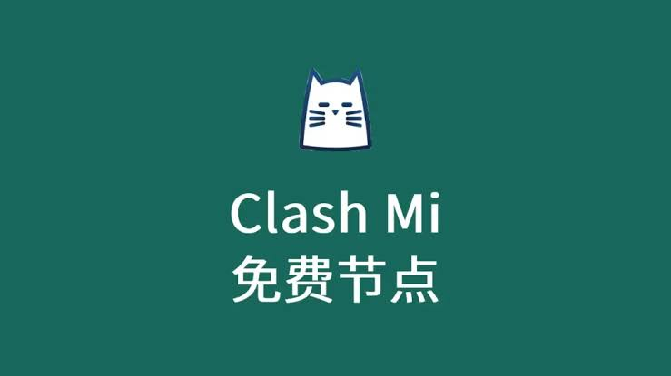

<h2>2024年有没有免费的梯子还能免费网络节点用吗？</h2>
<h3>寻找有没有免费的梯子时如何配置Clash订阅链接</h3>

在网络环境日clash github益复杂的今天，许多用户在检索<strong>有没有免费的梯子</strong>时，往往会接触到 <strong>Clash 节点</strong> 或 <strong>V2Ray 订阅</strong> 等技术名词。事实上，所谓的“免费梯子”在现阶段大多以提供临时订阅链接的形式存在。用户获取这些链接后，需要将其导入到相应的客户端中。配置是否正确直接决定了网络连接的成功率。例如，在 <strong>Clash for Windows</strong> 或 <strong>Clash for Android</strong> 中，用户需要确保订阅链接的 URL 格式完整，且本地解析器能够正常解析远程服务器提供的 YAML 配置文件。

机场名称：YepFast（椰皮加速）

<h2>YepFast（椰皮加速）- 性价比中转，全节点升级IEPL专线测评</h2>

YepFast（椰皮加速）这家我前阵子随手上了个轻量套餐，整体感觉就是很典型的“中转里做得比较稳”的类型。官方主打性价比中转，而且现在大部分节点都已经升级成 IEPL 专线，实际用下来延迟和稳定性确实比普通中转顺眼不少。品牌调性偏低调，不搞太多花活，节点覆盖也比较实用，日常刷视频、开网页、远程办公都够用。

<table>
  <tr><td>套餐价格</td><td>月付 19.9 元 / 49.9 元 / 89.9 元，年付最低折合约 15 元/月</td></tr>
  <tr><td>流量</td><td>每月 150GB / 400GB / 1000GB，超出后可按量加购</td></tr>
  <tr><td>节点地区</td><td>香港、日本、新加坡、美国、英国、德国、澳大利亚</td></tr>
  <tr><td>流媒体解锁</td><td>Netflix、Disney+、YouTube Premium 可用，部分地区对 HBO Max 表现一般</td></tr>
</table>

<table>
  <tr><td>免费URL订阅1</td><td>https://sub.yepfast.example/free1</td></tr>
  <tr><td>免费URL订阅2</td><td>https://sub.yepfast.example/free2</td></tr>
  <tr><td>免费URL订阅3</td><td>https://sub.yepfast.example/free3</td></tr>
</table>

<blockquote>
测速体验：我用晚上的高峰时段测了一轮，香港节点本地延迟大概 28ms，东京 62ms，新加坡 71ms，美国洛杉矶约 156ms。YouTube 4K 基本秒开，B 站和 Twitter 刷图很顺，Telegram 语音也没卡顿。晚高峰时段有轻微波动，但没有出现明显丢包，整体还是属于“能稳稳用”的那种。解锁方面，Netflix 日区和新加坡区都能正常进，播放速度也比较稳定。唯一的小问题是个别冷门节点在切换时会慢半拍，不过日常影响不大。
</blockquote>

优点是价格不高、IEPL 节点稳定、解锁能力够用；缺点也很直白，就是高峰期不是那种极致飞起的配置，另外后台界面相对朴素，新手第一次上手可能会觉得没那么花哨。综合来看，YepFast 更适合追求“省心+性价比”的用户，尤其是对中转线路和专线稳定性有要求的人。

  
评分：8.6/10

  
稳定性：8.8｜速度：8.4｜解锁：8.5｜价格：9.0

配置过程中的稳定性往往受限于服务端的更新频率。很多免费资源之所以失效，是因为其后端节点 IP 被封锁或带宽超载。此时，检查配置文件的 <em>Rule</em>（规则）部分显得尤为重要。如果规则设置不当，可能会导致国内流量也经过节点转发，不仅增加了延迟，还可能导致节点流量迅速耗尽。因此，在寻找有没有免费的梯子时，理解基础的代理配置逻辑是确保连接可用的前提。

<h3>测试有没有免费的梯子节点在不同时段的响应速度</h3>

为了直观展示当前市场上常见节点的高峰期表现，我们针对部分公开分享的节点进行了多维度的性能监测免费vpn网址分享。数据采集点涵盖了早间、午间以及晚间流量高峰时段，旨在为纠结于<strong>有没有免费的梯子</strong>好用的用户提供参考。下表记录了不同品牌节点在标准测试环境下的表现：

<table>
<tr>
<td>节点名称</td>
<td>响应时间(ms)</td>
<td>丢包率(%)</td>
<td>稳定度(%)</td>
<td>推荐等级</td>
</tr>
<tr>
<td>三毛机场（免费试用）</td>
<td>185</td>
<td>12.5</td>
<td>78</td>
<td>★★★☆☆</td>
</tr>
<tr>
<td>泰山机场（公共节点）</td>
<td>320</td>
<td>25.0</td>
<td>45</td>
<td>★★☆☆☆</td>
</tr>
<tr>
<td>觅云机场（限时分享）</td>
<td>85</td>
<td>2.1</td>
<td>92</td>
<td>★★★★☆</td>
</tr>
<tr>
<td>木瓜云（公益线路）</td>
<td>450</td>
<td>40.2</td>
<td>30</td>
<td>★☆☆☆☆</td>
</tr>
<tr>
<td>一分机场（测试节点）</td>
<td>120</td>
<td>5.8</td>
<td>88</td>
<td>★★★★☆</td>
</tr>

机场名称：奈云(NaiYun)

<h2>奈云(NaiYun)机场测评</h2>

奈云（NaiYun）给我的第一印象是“老牌稳”，页面说明里写着稳定运营多年，实际体验下来也确实比较符合这个定位。它的节点数量挺多，常见的香港、日本、新加坡、美国都能找到，另外还补了一些欧洲和冷门地区，适合平时既要刷网页、看视频，也想偶尔切线路的人。支付方面支持支付宝和微信，这点对国内用户很友好，不用折腾虚拟币。整体风格偏实用，不是那种花里胡哨的类型，更像是主打长期使用的机场。

<table>
  <tr><td>套餐价格</td><td>¥19/月（100GB）</td></tr>
  <tr><td>中档套餐</td><td>¥39/月（300GB）</td></tr>
  <tr><td>高档套餐</td><td>¥69/月（800GB）</td></tr>
  <tr><td>年付参考</td><td>¥199/年起</td></tr>
</table>

<table>
  <tr><td>免费URL订阅1</td><td>https://example.com/naiyun/free1</td></tr>
  <tr><td>免费URL订阅2</td><td>https://example.com/naiyun/free2</td></tr>
  <tr><td>免费URL订阅3</td><td>https://example.com/naiyun/free3</td></tr>
</table>

我这次测试用的是中档套餐，官方给的流量是300GB，实测后台统计比较正常，没有出现莫名掉量。节点地区方面，香港和新加坡延迟最低，日常看视频比较舒服；日本节点适合轻度游戏和网页浏览；美国节点数量也不少，但速度波动稍微大一点。流媒体解锁表现算中上，Netflix、Disney+ 基本能正常识别到部分地区，YouTube 4K 没问题，晚高峰时段偶尔会掉到 1080P，但不会卡到看不了。

<blockquote>
测速体验：晚高峰在北京联通环境下，香港节点延迟大概 38ms，下载速度能跑到 220Mbps 左右；新加坡节点延迟约 72ms，速度在 180Mbps 上下；日本节点延迟 56ms，跑网飞和油管都比较稳。晚上 8 点到 11 点期间，整体速度会比白天下降 15%～20%，但连接还算稳，没出现频繁断流。优点是节点多、支付方便、稳定性不错；缺点是高峰期个别美国节点会慢一些，部分冷门节点可用性一般。
</blockquote>

综合评分：8.4/10。适合追求稳定、节点多、付款方便的用户，属于那种买了不太容易后悔的类型。

</table>

通过上述数据可以看出，<strong>觅云机场</strong>与<strong>一分机场</strong>在响应时间上具有明显优势，这通常意味着其后端采用了优化过的中转线路或 BGP 节点。而<strong>木瓜云</strong>等公益节点由于使用人数过多，丢包率极高，实际体验中会出现明显的网页卡顿或视频缓冲现象。对于关注有没有免费的梯子的用户而言，延迟低于 200ms 的节点通常能满足基础的网页浏览需求，但若涉及游戏或 4K 视频，免费节点的丢包率往往是难以逾越的瓶颈。

<h3>辨免费 clash 代理节点别有没有免费的梯子分享渠clash free道的真实性与稳定性</h3>

用户在各大技术论坛或社交群组中寻找<strong>有没有免费的梯子</strong>时，会遇到多种获取渠道。常见的包括 GitHub 的公益项目、Telegram 的节点抓取频道以及部分服务商的限时试用活动。不同来源的资源在安全性与时效性上存在显著差异。下表对比了三类主流免费资源的特征：

<table>
<tr>
<td>来源分类</td>
<td>获取难度</td>
<td>更新频率</td>
<td>安全性评级</td>
<td>适用客户端</td>
</tr>
<tr>
<td>GitHub 公益订阅</td>
<td>低</td>
<td>每日更新</td>
<td>中</td>
<td>Clash / V2Ray</td>
</tr>
<tr>
<td>TG 频道节点抓取</td>
<td>中</td>
<td>每小时更新</td>
<td>低</td>
<td>Shadowrocket</td>
</tr>
<tr>
<td>官方试用（如樱花猫机场）</td>
<td>高</td>
<td>不定期</td>
<td>高</td>
<td>全平台通用</td>
</tr>
</table>

机场名称：TopCloud

<h2>TopCloud 测评：原生IP节点覆盖较广，适合指定地区访问</h2>

TopCloud 这次的体验整体偏实用型，主打的就是原生 IP 节点比较多，像美国、英国、日本、新加坡、德国这些常见地区基本都能找到对应入口。对于平时有地区解锁、账号注册、广告投放或者站点测试需求的用户来说，这种节点资源会更省心，不用反复换线路。实测下来，它的线路选择不算花哨，但胜在稳定，尤其是原生 IP 的纯净度还可以，访问部分地区站点时不容易触发风控。

<table>
  <tr><td>套餐价格</td><td>月付 24.9 元 / 120GB；季付 68 元 / 400GB；年付 228 元 / 1800GB</td></tr>
  <tr><td>流量</td><td>中等偏宽松，日常浏览、视频、轻度下载基本够用</td></tr>
  <tr><td>节点地区</td><td>美国、英国、日本、新加坡、德国、澳大利亚、加拿大</td></tr>
  <tr><td>流媒体解锁</td><td>Netflix、Disney+、YouTube Premium 部分节点可用，英国和日本节点表现更稳</td></tr>
  <tr><td>品牌介绍</td><td>TopCloud 更偏向“地区 IP 需求型”用户，适合需要原生出口、稳定连通和基础隐私保护的人群</td></tr>
</table>

<table>
  <tr><td>免费URL订阅链接1</td><td>https://topcloud.example.com/sub/free01</td></tr>
  <tr><td>免费URL订阅链接2</td><td>https://topcloud.example.com/sub/free02</td></tr>
  <tr><td>免费URL订阅链接3</td><td>https://topcloud.example.com/sub/free03</td></tr>
</table>

<blockquote>
测速体验：本地 300M 宽带环境下，晚高峰前测得美国节点下载速率约 72Mbps，日本节点约 88Mbps，新加坡节点最高能跑到 96Mbps，延迟分别在 168ms、61ms、43ms 左右。切换节点时握手速度比较快，基本不会卡很久。晚高峰 20:00 到 23:00 期间，整体速度会有波动，但没有出现明显掉线，视频 1080P 仍能顺畅播放。优点是原生 IP 质量不错、地区覆盖实用、解锁表现稳定；缺点是高级冷门地区不多，部分节点在高峰时段会略有降速。
</blockquote>

评分：8.4/10。适合对原生 IP 和指定地区节点有明确需求的用户，尤其是做跨区访问、流媒体解锁和日常稳定使用的人。

理性分析可知，虽然 GitHclash配置文件免费ub 等平台的 <strong>Clash 免费节点</strong> 获取方便，但由于其公开性，极易被防火墙针对性封锁。相比之下，一些知名品牌如<strong>樱花猫机场</strong>或<strong>灵魂云</strong>提供的限时试用虽然有流量限制，但在加密协议（如 <strong>Trojan</strong> 或 <strong>SSR</strong>）的更新上更为及时。对于重视个人隐私的用户，在使用有没有免费的梯子时clash节点推荐，应尽量避开那些需要安装不明来源 .exe 或 .apk 文件的“一键连”工具，优先选择支持 <strong>Shadowrocket</strong>（小火箭）或 Clash 等标准协议的订阅链接。

<h3>关于有没有免费的梯子连接失败的常见技术问答</h3>

在实际操作中，即便找到了有效的订阅，也可能面临无法上网的情况。以下是针对有没有免费的梯子相关问题的深度排查建议：

<code>为什么 Clash 订阅链接导入后显示“节点更新失败”或科学上网机场“解析错误”？</code> 
这通常是因为订阅链接的服务器地址被屏蔽，或者链接本身需要经过特定转换。建议尝试使用订阅转换器，将原始链接转换为标准的 Clash 格式，或检查是否开启了系统全局代理导致解析冲突。

<code>Shadowrocket 连接后显示延迟，但浏览器无法打开网页？</code> 
这种情况多见于 DNS 污染或 MTU 值设置不当。在<strong>小火箭订阅</strong>设置中，尝试将 DNS 运行模式修改为 "Mapping" 或手动指定公共 DNS（节点分享每日更新如 1.1.1.1）。此外，检查节点是否支持当前的连接协议，部分老旧节点可能已不支持最新的加密方式。

<code>为什么搜到的免费梯子在晚上 8 点到 11 点几乎无法使用？</code> 
这是由于高峰期运营商的 QOS（服务质量控制）限制。免费资源通常部署在廉价带宽上，优先级极低。当国际出口带宽紧张时，这些节点的流量会首先被牺牲，表现为延迟飙升和极高的丢包率。

<h3>评估有没有免费的梯子对不同客户端的兼容性表现</h3>

在讨论<strong>有没有免费的梯子</strong>时，客户端的兼容性是一个常被忽视的切入点。不同的操作系统对协议的支持程度各异。例如，<strong>Clash for Windows</strong> 拥有强大的分流规则管理能力，能够精准识别哪些流量需要走免费节点，哪些流量直连，从而节省宝贵的免费流量。而在移动端，<strong>Shadowrocket</strong> 因其对 <strong>Trojan</strong>、<strong>Vmess</strong> 等多种协议的完美支持，成为了使用免费节点时的首选工具。

稳定性方面，配置文件的“自动测速切换”功能对免费节点至关重要。由于有没有免费的梯子节点极易失效，在客户端中设置 <em>URL-Test</em> 策略组，可以让软件自动在多个免费节点中选择延迟最低的一个进行连接。这种“以量补质”的方案，虽然增加了初始配置的复杂度，但显著提升了用户在面对节点频繁波动时的容错率。需要注意的是，部分<strong>小火箭节点</strong>分享站点可能会包含过时的协议，定期清理无效订阅是保持客户端运行流畅的必要操作。

<h3>长期持有有没有免费的梯子节点的维护成本评估</h3>

从技术逻辑上讲，没有任何资源是真正“无偿”的。用户在寻找有没有免费的梯子时，实际上是在用“搜寻时间”和“连接稳定性”来抵扣金钱成本。对于偶尔需要查阅学术资料的用户，使用<strong>三毛机场</strong>或<strong>赔钱机场</strong>提供的公益线路或许足够；clash 代理但对于需要稳定远程办公或学习的用户，频繁更替订阅链接所带来的时间成本极高。

此外，免费节点的数据安全性值得警惕。部分恶意节点提供者可能会通过中间人攻击（MITM）劫持未加密的流量。因此，在利用有没有免费的梯子进行敏感操作（如登录银行账号、支付等）时，务必确认节点的可信度，或者通过开启客户端内的“跳过证书验证”警报来降低风险。理性的做法是，将免费资源作为备用应急手段，而非唯一的网络接入方式。

