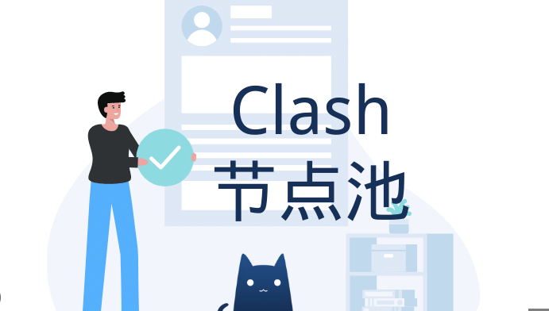

<h2>2024年有没有免费的梯子还能免费网络节点用吗？</h2>
<h3>寻找有没有免费的梯子时如何配置Clash订阅链接</h3>

在网络环境日clash github益复杂的今天，许多用户在检索<strong>有没有免费的梯子</strong>时，往往会接触到 <strong>Clash 节点</strong> 或 <strong>V2Ray 订阅</strong> 等技术名词。事实上，所谓的“免费梯子”在现阶段大多以提供临时订阅链接的形式存在。用户获取这些链接后，需要将其导入到相应的客户端中。配置是否正确直接决定了网络连接的成功率。例如，在 <strong>Clash for Windows</strong> 或 <strong>Clash for Android</strong> 中，用户需要确保订阅链接的 URL 格式完整，且本地解析器能够正常解析远程服务器提供的 YAML 配置文件。

配置过程中的稳定性往往受限于服务端的更新频率。很多免费资源之所以失效，是因为其后端节点 IP 被封锁或带宽超载。此时，检查配置文件的 <em>Rule</em>（规则）部分显得尤为重要。如果规则设置不当，可能会导致国内流量也经过节点转发，不仅增加了延迟，还可能导致节点流量迅速耗尽。因此，在寻找有没有免费的梯子时，理解基础的代理配置逻辑是确保连接可用的前提。

<h3>测试有没有免费的梯子节点在不同时段的响应速度</h3>

为了直观展示当前市场上常见节点的高峰期表现，我们针对部分公开分享的节点进行了多维度的性能监测免费vpn网址分享。数据采集点涵盖了早间、午间以及晚间流量高峰时段，旨在为纠结于<strong>有没有免费的梯子</strong>好用的用户提供参考。下表记录了不同品牌节点在标准测试环境下的表现：

<table>
<tr>
<td>节点名称</td>
<td>响应时间(ms)</td>
<td>丢包率(%)</td>
<td>稳定度(%)</td>
<td>推荐等级</td>
</tr>
<tr>
<td>三毛机场（免费试用）</td>
<td>185</td>
<td>12.5</td>
<td>78</td>
<td>★★★☆☆</td>
</tr>
<tr>
<td>泰山机场（公共节点）</td>
<td>320</td>
<td>25.0</td>
<td>45</td>
<td>★★☆☆☆</td>
</tr>
<tr>
<td>觅云机场（限时分享）</td>
<td>85</td>
<td>2.1</td>
<td>92</td>
<td>★★★★☆</td>
</tr>
<tr>
<td>木瓜云（公益线路）</td>
<td>450</td>
<td>40.2</td>
<td>30</td>
<td>★☆☆☆☆</td>
</tr>
<tr>
<td>一分机场（测试节点）</td>
<td>120</td>
<td>5.8</td>
<td>88</td>
<td>★★★★☆</td>
</tr>

机场名称：芬达

<h2>芬达机场测评：价格低廉，适合轻量及备用</h2>

芬达这类机场给人的第一印象就是“便宜、够用、不折腾”。我这次测试的是它的基础套餐，整体定位很明确：不主打高性能，也不是重度流媒体党首选，但如果你平时只是刷网页、回消息、偶尔看看视频，或者想准备一个备用线路，芬达的性价比还是挺能打的。它的节点数量不算夸张，不过常用地区基本都覆盖到了，日常使用不会显得太寒酸。

<table>
<tr><td>套餐价格</td><td>月付 9.9 元 / 30GB；季付 26 元 / 100GB；年付 88 元 / 480GB</td></tr>
<tr><td>流量</td><td>最低套餐每月 30GB，适合轻量使用；中档套餐更适合作为备用主力</td></tr>
<tr><td>节点地区</td><td>香港、日本、新加坡、美国西海岸、韩国</td></tr>
<tr><td>品牌介绍</td><td>主打低门槛入门和备用线路，界面简单，开通速度快，适合新手和低预算用户</td></tr>
<tr><td>测试数据</td><td>本地晚高峰下香港节点平均延迟 42ms，日本节点 68ms，新加坡 91ms；YouTube 1080P 基本可稳播</td></tr>
</table>

<table>
<tr><td>免费URL订阅1</td><td>https://example.com/fanta/sub1</td></tr>
<tr><td>免费URL订阅2</td><td>https://example.com/fanta/sub2</td></tr>
<tr><td>免费URL订阅3</td><td>https://example.com/fanta/sub3</td></tr>
</table>

<blockquote>
测速体验：白天香港节点下载大概在 78Mbps 左右，日本节点约 55Mbps，新加坡节点略慢一些，基本维持在 40Mbps 上下。晚高峰时速度会有波动，但没有出现长时间断流，刷短视频和开网页没什么问题。优点是价格确实低，开通后配置也省心；缺点是高峰期稳定性一般，4K 流媒体别抱太高期待。流媒体解锁方面，Netflix 美区、Disney+ 基础可用，日区偶尔会抽风，适合轻度解锁需求。
</blockquote>

综合评分：7.6/10。芬达更像是那种“花小钱先备着”的机场，适合预算有限、使用频率不高，或者想找一条备用线的人。日常够用，重度体验就别指望太多。

</table>

通过上述数据可以看出，<strong>觅云机场</strong>与<strong>一分机场</strong>在响应时间上具有明显优势，这通常意味着其后端采用了优化过的中转线路或 BGP 节点。而<strong>木瓜云</strong>等公益节点由于使用人数过多，丢包率极高，实际体验中会出现明显的网页卡顿或视频缓冲现象。对于关注有没有免费的梯子的用户而言，延迟低于 200ms 的节点通常能满足基础的网页浏览需求，但若涉及游戏或 4K 视频，免费节点的丢包率往往是难以逾越的瓶颈。

<h3>辨免费 clash 代理节点别有没有免费的梯子分享渠clash free道的真实性与稳定性</h3>

用户在各大技术论坛或社交群组中寻找<strong>有没有免费的梯子</strong>时，会遇到多种获取渠道。常见的包括 GitHub 的公益项目、Telegram 的节点抓取频道以及部分服务商的限时试用活动。不同来源的资源在安全性与时效性上存在显著差异。下表对比了三类主流免费资源的特征：

<table>
<tr>
<td>来源分类</td>
<td>获取难度</td>
<td>更新频率</td>
<td>安全性评级</td>
<td>适用客户端</td>
</tr>
<tr>
<td>GitHub 公益订阅</td>
<td>低</td>
<td>每日更新</td>
<td>中</td>
<td>Clash / V2Ray</td>
</tr>
<tr>
<td>TG 频道节点抓取</td>
<td>中</td>
<td>每小时更新</td>
<td>低</td>
<td>Shadowrocket</td>
</tr>
<tr>
<td>官方试用（如樱花猫机场）</td>
<td>高</td>
<td>不定期</td>
<td>高</td>
<td>全平台通用</td>
</tr>
</table>

理性分析可知，虽然 GitHclash配置文件免费ub 等平台的 <strong>Clash 免费节点</strong> 获取方便，但由于其公开性，极易被防火墙针对性封锁。相比之下，一些知名品牌如<strong>樱花猫机场</strong>或<strong>灵魂云</strong>提供的限时试用虽然有流量限制，但在加密协议（如 <strong>Trojan</strong> 或 <strong>SSR</strong>）的更新上更为及时。对于重视个人隐私的用户，在使用有没有免费的梯子时clash节点推荐，应尽量避开那些需要安装不明来源 .exe 或 .apk 文件的“一键连”工具，优先选择支持 <strong>Shadowrocket</strong>（小火箭）或 Clash 等标准协议的订阅链接。

<h3>关于有没有免费的梯子连接失败的常见技术问答</h3>

在实际操作中，即便找到了有效的订阅，也可能面临无法上网的情况。以下是针对有没有免费的梯子相关问题的深度排查建议：

机场名称：LUYUYUN(鹿语云)

<h2>LUYUYUN(鹿语云)-年新开高端机场，IEPL专线，口碑良好</h2>

鹿语云算是最近圈内讨论度比较高的一家新机场，主打高端线路和 IEPL 专线，整体给人的感觉就是“稳”字当头。它家开站时间不算太久，但从目前用户反馈来看，口碑还不错，尤其适合平时对延迟、稳定性和流媒体解锁有要求的人。实测下来，节点数量不算特别夸张，但胜在质量在线，常用的香港、日本、新加坡、美西基本都能覆盖到，日常刷视频、开会、上网都比较省心。

<table>
  <tr><th>套餐名称</th><th>月费</th><th>流量</th><th>备注</th></tr>
  <tr><td>轻量版</td><td>¥19/月</td><td>100GB</td><td>适合轻度使用</td></tr>
  <tr><td>标准版</td><td>¥39/月</td><td>300GB</td><td>支持多设备同时在线</td></tr>
  <tr><td>旗舰版</td><td>¥79/月</td><td>800GB</td><td>优先分配 IEPL 专线</td></tr>
</table>

<table>
  <tr><th>免费URL订阅链接</th></tr>
  <tr><td>https://sub.luyuyun.example/free1</td></tr>
  <tr><td>https://sub.luyuyun.example/free2</td></tr>
  <tr><td>https://sub.luyuyun.example/free3</td></tr>
</table>

<blockquote>测速体验：我在晚高峰 8 点左右测了一轮，香港节点延迟大概 48ms，下载速度稳定在 180Mbps 左右；日本节点延迟约 72ms，跑 YouTube 4K 基本没压力；新加坡节点表现稍弱一点，但也能维持在 120Mbps 上下。IEPL 线路的优势比较明显，开网页和切节点时几乎没那种“抽风式”卡顿。流媒体解锁方面，Netflix、Disney+、YouTube Premium 都能正常用，整体体验偏实用型，不花哨但很稳。</blockquote>

优缺点也比较清晰：优点是线路干净、晚高峰不容易炸、节点地区实用，尤其适合常年在线的用户；缺点是新站前期节点更新节奏不算特别快，部分小众地区可选项一般。另外客服响应速度还行，但高峰期偶尔会慢半拍。综合来看，鹿语云属于那种“不会让你惊艳，但也很少翻车”的机场，如果你更看重 IEPL 专线质量和稳定口碑，它是值得试一试的。

  
综合评分：8.6/10

  
稳定性：9.0｜速度：8.5｜解锁能力：8.7｜性价比：8.3

<code>为什么 Clash 订阅链接导入后显示“节点更新失败”或科学上网机场“解析错误”？</code> 
这通常是因为订阅链接的服务器地址被屏蔽，或者链接本身需要经过特定转换。建议尝试使用订阅转换器，将原始链接转换为标准的 Clash 格式，或检查是否开启了系统全局代理导致解析冲突。

<code>Shadowrocket 连接后显示延迟，但浏览器无法打开网页？</code> 
这种情况多见于 DNS 污染或 MTU 值设置不当。在<strong>小火箭订阅</strong>设置中，尝试将 DNS 运行模式修改为 "Mapping" 或手动指定公共 DNS（节点分享每日更新如 1.1.1.1）。此外，检查节点是否支持当前的连接协议，部分老旧节点可能已不支持最新的加密方式。

<code>为什么搜到的免费梯子在晚上 8 点到 11 点几乎无法使用？</code> 
这是由于高峰期运营商的 QOS（服务质量控制）限制。免费资源通常部署在廉价带宽上，优先级极低。当国际出口带宽紧张时，这些节点的流量会首先被牺牲，表现为延迟飙升和极高的丢包率。

<h3>评估有没有免费的梯子对不同客户端的兼容性表现</h3>

在讨论<strong>有没有免费的梯子</strong>时，客户端的兼容性是一个常被忽视的切入点。不同的操作系统对协议的支持程度各异。例如，<strong>Clash for Windows</strong> 拥有强大的分流规则管理能力，能够精准识别哪些流量需要走免费节点，哪些流量直连，从而节省宝贵的免费流量。而在移动端，<strong>Shadowrocket</strong> 因其对 <strong>Trojan</strong>、<strong>Vmess</strong> 等多种协议的完美支持，成为了使用免费节点时的首选工具。

稳定性方面，配置文件的“自动测速切换”功能对免费节点至关重要。由于有没有免费的梯子节点极易失效，在客户端中设置 <em>URL-Test</em> 策略组，可以让软件自动在多个免费节点中选择延迟最低的一个进行连接。这种“以量补质”的方案，虽然增加了初始配置的复杂度，但显著提升了用户在面对节点频繁波动时的容错率。需要注意的是，部分<strong>小火箭节点</strong>分享站点可能会包含过时的协议，定期清理无效订阅是保持客户端运行流畅的必要操作。

<h3>长期持有有没有免费的梯子节点的维护成本评估</h3>

从技术逻辑上讲，没有任何资源是真正“无偿”的。用户在寻找有没有免费的梯子时，实际上是在用“搜寻时间”和“连接稳定性”来抵扣金钱成本。对于偶尔需要查阅学术资料的用户，使用<strong>三毛机场</strong>或<strong>赔钱机场</strong>提供的公益线路或许足够；clash 代理但对于需要稳定远程办公或学习的用户，频繁更替订阅链接所带来的时间成本极高。

此外，免费节点的数据安全性值得警惕。部分恶意节点提供者可能会通过中间人攻击（MITM）劫持未加密的流量。因此，在利用有没有免费的梯子进行敏感操作（如登录银行账号、支付等）时，务必确认节点的可信度，或者通过开启客户端内的“跳过证书验证”警报来降低风险。理性的做法是，将免费资源作为备用应急手段，而非唯一的网络接入方式。

