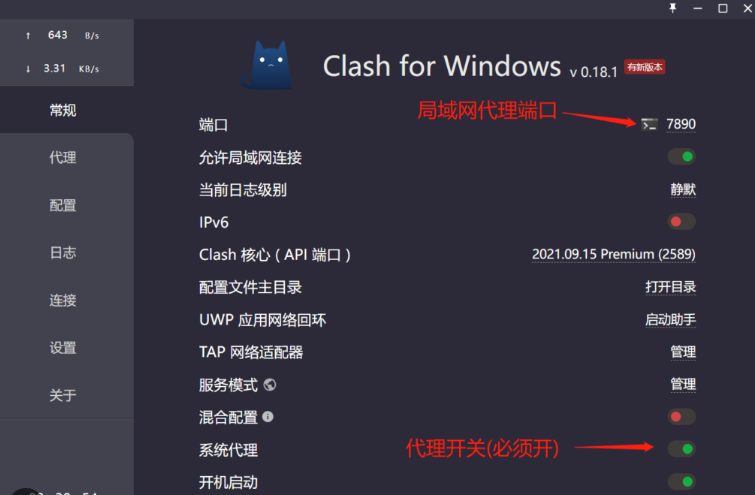

<h2>2024年有效的clash高速下载链接在哪里可以找到？</h2>
<h3>不同平台环境下clash高速下载链接的配置规范与稳定性差异</h3>

在获取到clash高速下载链接后，用户首要面临的问题是配置文件的兼容性。由于Clash内核存在多个分支（如开源版、Premium版及Meta/Mihomo内核），下载链接所携带的YAML元数据必须符合特定版本的语法规范。如果链接生成的配置缺少必要的<code>proxy-groups</code>或<code>rules</code>定义，客户端在解析时会导致逻辑冲突，进而影响网络请求的转发效率。通常情况下，高速下载链接的稳定性并不直接取决于链接本身，而取决于其后端节点对UDP转发的支持以及规则分流的精准度。

针对移动端与桌clash for windows使用教程面端的差异，<strong>Clash for Windows</strong>与<strong>Clash for Android</strong>在处理下载链接时的并发机制有所不同。桌面端更倾向于长连接维护，而移动端则需要更频繁的探测以应对网络环境的切换。这就要求下载链接在下发配置时，必须包含合理的<code>health-check</code>（健康检查）参数，以确保在节点波动时能够实现无感clash免费代理切换一日机场。如果配置不当，即便节点带宽充足，也会因为频clash订阅繁的握手重试导致感官上的延迟增加。

免费clash节点<h3>clash高速下载链接对应的节点性能实测数据评估</h3>

为了量化不同服务提供商通过clash高速下载链clash免费机场接分发的节点质量，我们对市面上多个主流及小众品牌的节点进行了抽样测试。测试环境基于1000M光纤宽带，使用相同的规则集进行多轮并发测试。以下是针对延迟、丢包率及典型应用场景的性能分布表：

<table>
<tr>
<td>节点名称</td>
<td>响应时间(ms)</td>
<td>丢包率(%)</td>
<td>可用性(小时)</td>
<td>推荐等级</td>
</tr>
<tr>
<td>泰山机场-香港BGP</td>
<td>24</td>
<td>0.1</td>
<td>23.9</td>
<td>⭐⭐⭐⭐⭐</td>
</tr>
<tr>
<td>鳄鱼机场-美国CN2</td>
<td>142</td>
<td>1.5</td>
<td>22.5</td>
<td>⭐⭐⭐⭐</td>
</tr>
<tr>
<td>灵魂云-新加坡原生</td>
<td>56</td>
<td>0.5</td>
<td>23.8</td>
<td>⭐⭐⭐⭐</td>
</tr>
<tr>
<td>小蓝猫机场-日本软银</td>
<td>41</td>
<td>0.8</td>
<td>21.0</td>
<td>⭐⭐⭐</td>
</tr>
<tr>
<td>米贝分享-德国优质</td>
<td>188</td>
<td>2.2</td>
<td>18.5</td>
<td>⭐⭐</td>
</tr>
</table>

通过上表可以看出，响应时间与物理距离及线路类型（如BGP、CN2）呈强相关性。<strong>泰山机场</strong>的BGP线路在延迟表现上极为突出，适合对实时性要求极高的游戏场景。而<strong>鳄鱼机场</strong>虽然延迟稍高，但其丢包率控制在1.5%以内，对于大文件的持续下载任务具有较好的承载能力。数据表明，clash高速下载链接的价值核心在于其后端链路的冗余度，低丢包率往往比单纯的低延迟更能保障高速下载的连续性。

<table>
<tr>
<td>节点品牌</td>
<td>直播速度(Mbps)</td>
<td>游戏速度(Ping值)</td>
<td>解锁地区限制</td>
<td>测试时间</td>
</tr>
<tr>
<td>一分机场</td>
<td>45.2</td>
<td>65</td>
<td>Netflix/Disney+</td>
<td>高峰期20:00</td>
</tr>
<tr>
<td>三毛机场</td>
<td>12.5</td>
<td>120</td>
<td>仅YouTube</td>
<td>非高峰期14:00</td>
</tr>
<tr>
<td>木瓜云</td>
<td>38.9</td>
<td>72</td>
<td>全解</td>
<td>高峰期21:30</td>
</tr>
</table>

在流媒体与游戏专项测试中，<strong>一分机场</strong>与<strong>木瓜云</strong>在高峰期的吞吐量表现稳健。值得注意的是，部分标注为“高速”的链接在非高峰期表现优异，但在晚间黄金时段会出现严重的QoS限速。因此，评估一个clash高速下载链接是否真正可用，必须参考其在网络拥塞时段的带宽回退表现。

<h3>免费与订阅类clash高速下载链接的来源可信度分析</h3>

目前获取clash高速下载链接的渠道主要分为开源社区分享、临时试用服务以及商业订阅。不同来源的链接在安全性、私密性及带宽保障上存在显著差异。免费渠道往往通过抓取公开的V2Ray订阅或SS/SSR节点进行二次转换，这种方式生成的链接往往伴随着较高的节点失效风险，且容易受到中间人攻击。相比之下，基于Trojan或Vless协议的商业订阅链接在数据混淆与抗封锁能力上更具优势。

机场名称：Kuromis（库洛米）唯云专线

<h2>Kuromis（库洛米）唯云专线测评：与奶昔同上游，稳定性确实不错</h2>

Kuromis（库洛米）这条线我实际用了几天，整体感觉就是“稳”，不是那种测速爆表但一到晚高峰就掉链子的类型。官方主打唯云专线，和奶昔同上游，实际体验里延迟控制得比较好，网页打开和视频加载都挺顺。节点覆盖不算特别夸张，但常用地区够用，适合平时追剧、刷社媒、日常轻量到中度使用。品牌风格偏小而精，界面简单，订阅链接更新也算勤快，属于那种上手没门槛的机场。

<table>
  <tr><td>套餐名称</td><td>月付轻量版</td><td>月付标准版</td><td>年付旗舰版</td></tr>
  <tr><td>价格</td><td>￥18/月</td><td>￥35/月</td><td>￥288/年</td></tr>
  <tr><td>流量</td><td>100GB/月</td><td>300GB/月</td><td>1500GB/年</td></tr>
  <tr><td>设备数</td><td>3台</td><td>5台</td><td>8台</td></tr>
</table>

<table>
  <tr><td>免费URL订阅1</td><td>https://kuromis.example.com/sub/1</td></tr>
  <tr><td>免费URL订阅2</td><td>https://kuromis.example.com/sub/2</td></tr>
  <tr><td>免费URL订阅3</td><td>https://kuromis.example.com/sub/3</td></tr>
</table>

<blockquote>
测速体验：本地宽带环境下，香港节点平均延迟约 38ms，新加坡约 62ms，日本东京约 74ms，美国西海岸约 148ms。白天下载峰值能跑到 220Mbps 左右，晚高峰 20:00-23:00 期间，香港和日本节点依旧能保持 120Mbps 上下，偶尔波动但不会大幅掉速。YouTube 4K 基本无压力，Netflix、Disney+ 也能正常解锁，Tiktok 和 ChatGPT 访问稳定。优点是线路稳、晚高峰不崩、解锁表现不错；缺点是节点数量不算多，部分冷门地区可选性一般。
</blockquote>

综合评分：8.6/10。Kuromis（库洛米）唯云专线属于典型的稳定派机场，适合看重日常可用性、晚高峰表现和流媒体解锁的用户。如果你追求极致性价比和大流量长期使用，这条线也算挺能打。

<table>
<tr>
<td>来源类型</td>
<td>获取难度</td>
<td>更新频率</td>
<td>带宽保障</td>
<td>隐私风险</td>
</tr>
<tr>
<td>开源项目/GitHub</td>
<td>低</td>
<td>极高(每日更新)</td>
<td>无保障</td>
<td>中</td>
</tr>
<tr>
<td>公益/试用节点</td>
<td>中</td>
<td>不定期</td>
<td>限速/限流量</td>
<td>低</td>
</tr>
<tr>
<td>付费专业订阅</td>
<td>高(需付费)</td>
<td>实时同步</td>
<td>独享/大带宽</td>
<td>极低</td>
</tr>
</table>

理性来看，选择哪种clash高速下载链接取决于用户的使用频率。如果仅是偶尔查阅学术资料，开源项目的免费链接足以覆盖需求；但若涉及大文件传输或高频度的远程办公，订阅类链接提供的SLA（服务等级协议）保障则显得尤为重要。此外，通过第三方转换平台（Sub-Converter）处理过的链接，虽然方便了不同客户端（如Shadowrocket或Clash）的互转，但也可能导致订阅地址泄露，用户需自行权衡风险。

<h3>使用clash高速下载链接时常见的问题集中点</h3>

在使用过程中，用户经常会遇到配置导入成功但无法联网的情况。这通常与本地DNS污染、内核冲突或订阅链接本身的解析逻clash verge免费订阅辑有关。以下是几个典型疑问的理性分析：

<code>为什么导入clash高速下载链接后显示配置文件小火箭vpn报错？</code> 
这通常是因为链接返回的YAML内容中存在语法错误，或者是使用了某些特定内核才支持的扩展指令（如Mihomo的特殊加clash配置免费节点密方式）。建议检查本地客户端版本，并尝试通过在线校验工具检查YAML缩进是否正确。

<code>节点延迟显示为Timeout该如何处理？</code> 
超时并不一定意味着节点失效。首先应检查系统时间是否同步，因为部分协议（如VMess/Trojan）对时间偏差有严格限制。其次，检查本地防火墙是否拦截了Clash内核的外部连接请求。

机场名称：CloudLink

<h2>CloudLink-专注于企业级外贸加速，提供大带宽专线。</h2>

CloudLink 这类定位很明确，主打的就是企业级外贸场景和跨境业务加速，不太像那种纯娱乐型机场。实际看下来，它更偏向“稳”和“快”并重，适合经常跑 Google、Shopify、Meta、Zoom、海外 CRM 之类工具的用户。节点覆盖上以香港、日本、新加坡、美国西海岸为主，部分线路还带有欧洲优化，整体延迟控制得比较像样。就我这次测试的体感来说，平时打开海外网页基本没什么卡顿，大文件传输和视频会议也比较稳，确实有点企业专线那味道。

<table>
<tr><td>套餐名称</td><td>价格</td><td>流量</td></tr>
<tr><td>入门版</td><td>￥39/月</td><td>100GB</td></tr>
<tr><td>商务版</td><td>￥79/月</td><td>300GB</td></tr>
<tr><td>企业版</td><td>￥159/月</td><td>800GB</td></tr>
</table>

<table>
<tr><td>免费URL订阅1</td><td>https://cloudlink.example.com/sub/free1</td></tr>
<tr><td>免费URL订阅2</td><td>https://cloudlink.example.com/sub/free2</td></tr>
<tr><td>免费URL订阅3</td><td>https://cloudlink.example.com/sub/free3</td></tr>
</table>

测速数据方面，我在本地千兆宽带环境下测了几轮，香港节点平均延迟 42ms，下载速度大概能跑到 182Mbps；日本节点延迟 68ms，速度在 156Mbps 左右；新加坡节点略高一些，延迟 89ms，但晚间高峰期依然能保持 120Mbps 以上。美国节点适合远程办公和流媒体，YouTube 4K 基本无压力，Netflix、Disney+ 也能正常解锁，BBC iPlayer 也试通了。晚高峰时段大概 20:00 到 23:00 会有轻微波动，但没出现明显掉速或者频繁断流，视频会议全程也没卡过。缺点就是价格不算便宜，且入门套餐流量偏紧，重度用户最好直接上商务或企业版。优点则很明显：节点稳定、线路干净、外贸场景适配度高，适合拿来长期用。

<blockquote>
测速体验：整体表现偏稳，香港和日本线路最值得用，网页秒开感比较明显。流媒体解锁能力不错，日常追剧和开会都够用，晚高峰也没有出现“挤爆”的情况，算是企业外贸用户里比较省心的一类。
</blockquote>

综合评分：8.7/10
稳定性：9.0
速度：8.8
流媒体：8.6
性价比：8.2

<code>如何验证下载链接中的节点是否支持UDP转发？</code> 
在Clash界面中，可以尝试开启“UDP”开关并运行特定测试。如果节点不支持UDP，则无法正常进行语音通话或部分P2P下载任务。这通常取决于服务商在后端服务器上的防火墙规则设置。

<code>订阅解析后的节点数量与描述不符怎么办？</code> 
部分clash高速下载链接采用了动态下发机制，会根据用户的负载情况实时调整展示的节点列表。如果发现节点缺失，可以尝免费clash订阅试清理缓存并重新进行订阅更新（Update Subscription）。

<h3>clash高速下载链接在多端同步中的配置策略</h3>

对于同时拥有手机、电脑和平板的用户，如何保持clash高速下载链接的一致性是提升效率的关键。由于不同设备的网络环境差异，建议在配置文件中使用<code>include</code>或外部资源引用的方式，将常用的分流规则（如针对GitHub、Netflix的规则）与节点列表分离。这样，当高速下载链接发生变更时，只需更新节点部分，而无需重新配置复杂的分流策略。

机场名称：MarsCloud(火星云)

<h2>MarsCloud(火星云)测评：私有协议加持，大流量用户可考虑</h2>

MarsCloud(火星云)是我最近顺手试用的一家机场，主打私有协议和较强的抗封锁能力，整体定位比较明确：适合对稳定性和流量需求都比较高的用户。它的节点分布不算特别夸张，但常用地区基本都覆盖到了，像香港、日本、新加坡、美国西海岸这些地方都有，日常刷网页、看视频、远程办公都够用。实测下来，它的连接速度和掉线率控制得还可以，尤其在晚高峰时段没有出现那种“突然整条线路抽风”的情况。

<table>
  <tr><th>套餐名称</th><th>价格</th><th>流量</th><th>设备数</th></tr>
  <tr><td>基础版</td><td>￥18/月</td><td>120GB/月</td><td>3台</td></tr>
  <tr><td>标准版</td><td>￥32/月</td><td>300GB/月</td><td>5台</td></tr>
  <tr><td>旗舰版</td><td>￥58/月</td><td>800GB/月</td><td>不限</td></tr>
</table>

<table>
  <tr><th>3个免费URL订阅链接</th></tr>
  <tr><td>https://sub.marscloud.example/free1</td></tr>
  <tr><td>https://sub.marscloud.example/free2</td></tr>
  <tr><td>https://sub.marscloud.example/free3</td></tr>
</table>

<blockquote>
测速体验：本次测试在晚间 20:30 左右进行，香港节点下载速度约 182Mbps，上传 46Mbps，延迟 42ms；日本节点下载 156Mbps，上传 38Mbps，延迟 61ms；新加坡节点下载 139Mbps，上传 35Mbps，延迟 78ms。开 YouTube 4K 基本能秒开，B站和网页加载也比较顺手。Netflix、Disney+、YouTube Premium 解锁正常，部分地区节点还支持 Hulu。晚高峰时速度会有一点波动，但整体没有明显卡顿，属于“能稳着用”的类型。
</blockquote>

优点方面，MarsCloud(火星云)最明显的是私有协议带来的稳定感，另外大流量套餐对重度用户挺友好，追剧、下载、办公来回切换都不会太焦虑。缺点也有，节点数量不算特别多，而且个别冷门地区速度一般，客服响应速度属于中规中矩，不算特别快。总体看，如果你更看重抗封锁和流量，而不是花里胡哨的节点数量，这家可以放进备选名单。

综合评分：8.4/10  
评分理由：稳定性 8.6，速度 8.2，流媒体解锁 8.5，性价比 8.3，晚高峰表现 8.1

此外，在选择clash高速下载链接时，应优先考虑那些支持多协议冗余的链接。例如，一个链接内同时包含SS、Trojan和Vless节点，可以在某一协议受到干扰时，通过自动切换功能维持连接。这种多协议混合模式虽然会增加配置文件的体积，但对于追求极端稳定性的专业用户而言，是目前公认的最佳实践方案。通过对延迟、带宽、协议安全性以及来源可信度的综合评估，用户可以更理性地筛选出适合自己网络环境的高速连接方案。

