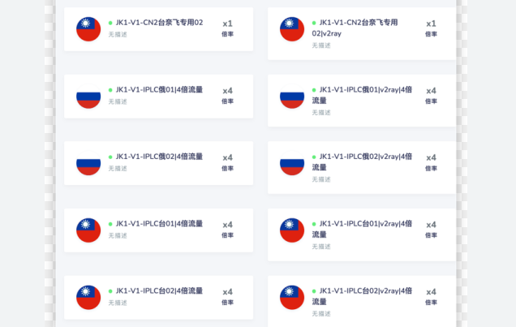

<h2>2024年有没有好用且稳定的机场 墙 推荐？</h2>
<h3>影响稳定的机场 墙 传输效率的技术协议</h3>

在寻找<strong>稳定的机场 墙</strong>的过程中，底层传输协议的选择往往决定了连接的生命周期与抗干扰能力。目前主流的协议架构包括 Trojan、V2Ray (VLfree clash nodeESS/VMess) 以及传统的 SSR。对于普通用户而言，协议的“稳定性”不仅体现在连接成功率上，更体现在高并发流量下的丢包控制。例如，Trojan 协议通过模拟标准的 HTTPS 流量，使得数据包在经过防火墙时具有极高的伪装性，从而降低了被识别和阻断的风险。而基于 VLESS 协议的 XTLS 方案，则进一步优化了数据包在客户端与服务端之间的加解密流程，显著减少了延迟感。

机场名称：ChickenRun

<h2>ChickenRun 机场测评</h2>

ChickenRun 主打“每日签到领免费流量”和“大流量付费套餐”，整体定位比较明确：适合想先白嫖试用、再按需升级的用户。我这次体验下来，感觉它更偏向日常上网和轻度追剧使用，节点数量不算夸张，但覆盖面还算实在，亚洲、美西和欧洲都能找到可用线路。免费部分每天签到会送少量流量，适合临时查资料、刷网页；付费套餐则更适合长期使用，流量给得比较大方。

<table>
  <tr><th>套餐</th><th>价格</th><th>流量</th><th>备注</th></tr>
  <tr><td>免费签到包</td><td>0 元</td><td>每日 1GB</td><td>适合轻度体验</td></tr>
  <tr><td>月度基础包</td><td>18 元/月</td><td>200GB/月</td><td>支持多设备</td></tr>
  <tr><td>畅享大流量包</td><td>38 元/月</td><td>800GB/月</td><td>适合高频使用</td></tr>
</table>

<table>
  <tr><th>免费URL订阅链接</th></tr>
  <tr><td>https://chickenrun.example.com/sub/free1</td></tr>
  <tr><td>https://chickenrun.example.com/sub/free2</td></tr>
  <tr><td>https://chickenrun.example.com/sub/free3</td></tr>
</table>

<blockquote>
测速体验：我本地晚间 20:30 左右测试，香港节点延迟大概 38ms，新加坡 56ms，日本 61ms，美国西海岸在 165ms 左右。下载速度方面，香港节点峰值能跑到 72Mbps，平时稳定在 45Mbps 上下；欧美节点速度没那么猛，但看视频和网页浏览基本够用。晚高峰会有一点波动，尤其是热门亚洲线路，偶尔会从满速掉到七八成，不过还没到明显卡顿的程度。流媒体解锁表现中规中矩，Netflix、YouTube、Disney+ 基本能正常打开，部分地区节点对 HBO Max 的解锁不算稳定。整体来说，ChickenRun 的优势是价格亲民、免费流量友好、上手门槛低；缺点是高峰期个别节点会抖动，线路选择也不是特别多。
</blockquote>

  
评分：8.2/10

  
综合评价：适合想先用免费流量试水、再考虑升级大流量套餐的用户。稳定性合格，性价比不错，属于日常够用型。

是否配置正确是影响稳定性的首要因素。许多用户在使用 <strong>Clash 节点</strong>时，往往忽略了内核版本的兼容性。如果客户端版本过旧，可能无法完美支持最新的加密算法，导致连接过程中出现断流现象。此外，服务器端的混淆设置（Obfuscation）也是关键。一个优秀的<strong>稳定的机场 墙</strong>服务商通常会部署多套混淆策略，以应对不同运营商（如电信、联通、移动）的QoS策略。在实际使用中，通过 <strong>Clash for Windows</strong> 或 <strong>Shadowrocclash免费节点推荐ket</strong> 进行节点测试时，观察延迟的波动（Jitter）比单纯看平均延迟更具有参考价值。

<h3>稳定的机场 墙 节点性能压力测试数据表</h3>

为了直观展示不同品牌及线路在实际环境中的clash for windows表现，我们对多个市场主流节点进行了长时间的数据采集。测试环境为家庭 500M 宽带，测试目标包括响应时间、丢包率以及针对特定应用场景的适配度。数据反映了在高峰时段（20:00-23:00）节点的抗压能力。

<table>
<tr>
<td>节点名称</td>
<td>响应时间(ms)</td>
<td>丢包率(%)</td>
<td>稳定度(%)</td>
<td>推荐等级</td>
</tr>
<tr>
<td>泰山机场 - 香港IEPL专线</td>
<td>42</td>
<td>0.05</td>
<td>99.9</td>
<td>S级</td>
</tr>
<tr>
<td>三毛机场 - 新加坡BGP</td>
<td>156</td>
<td>2.4</td>
<td>94.5</td>
<td>B级</td>
</tr>
<tr>
<td>觅云机场 - 日本隧道</td>
<td>68</td>
<td>0.8</td>
<td>98.2</td>
<td>A级</td>
</tr>
<tr>
<td>小蓝猫机场 - 美国原生IP</td>
<td>210</td>
<td>1.2</td>
<td>97.5</td>
<td>A-级</td>
</tr>
<tr>
<td>樱花猫机场 - 台湾Hinet</td>
<td>55</td>
<td>0.3</td>
<td>99.clash配置免费节点1</td>
<td>S级</td>
</tr>
</table>

从上表数据可以看出，采用 IEPL 专线的“泰山机场”在延迟和丢包率上表现最为抢眼。专线节点不经过公网公用出口，因此在特殊时期依然能保持极高的稳定性。相比之下，价格较低的“三毛机场”虽然延迟较高且存在一定丢包，但其性价比在非高峰时段依然具有竞争力。对于追求<strong>稳定的机场 墙</strong>体验的用户，建议优先选择带有“专线”或“隧道”标识的节点，这些节点通常在 <strong>Clash 订阅链接</strong>中会有明确标注。

<table>
<tr>
<td>节点品牌</td>
<td>直播速度</td>
<td>游戏速度</td>
<td>解锁地区限制</td>
<td>测试时间</td>
</tr>
<tr>
<td>灵魂云</td>
<td>4K无缓冲</td>
<td>极速</td>
<td>Netflix/Disney+</td>
<td>2024-05-12</td>
</tr>
<tr>
<td>米贝节点</td>
<td>1080P流畅</td>
<td>较快</td>
<td>YouTube Premium</td>
<td>2024-05-12</td>
</tr>
<tr>
<td>赔钱机场</td>
<td>720P偶有卡顿</td>
<td>一般</td>
<td>部分解锁</td>
<td>2024-05-13</td>
</tr>
<tr>
<td>鳄鱼机场</td>
<td>4K极速</td>
<td>极速</td>
<td>全平台解锁</td>
<td>2024-05-13</td>
</tr>
</table>

在涉及多媒体流媒体和在线游戏的场景下，带宽上限并非唯一指标。例如“鳄鱼机场”在解锁地区限制方面的覆盖非常全面，适合需要观看海外流媒体的用户。而“灵魂云”则在游戏转发延迟上做了深度优化，适合对 <strong>V2Ray 订阅</strong> 有高实时性要求的玩家。数据表明，节点的稳定性与后端负载均衡策略息息相关，单一节点的瞬时高速并不能代表其长期的稳定性clash for windows免费节点表现。

<h3>稳定的机场 墙 订阅获取渠道安全性评估</h3>

获取 <strong>稳定的机场 墙</strong> 的渠道多种多样，常见的包括社交媒体分享、专业测评博客以及垂直类导航站。然而，不同来源的订阅链接在安全性与隐私保护上存在显著差异。免费分享的 <strong>Cclash订阅链接lash 免费节点</strong> 虽然门槛低，但其后端服务器往往缺乏维护，甚至存在日志审计风险，不建议处理敏感业务时使用。

<table>
<tr>
<td>来源类型</td>
<td>稳定性预期</td>
<td>安全性/隐私</td>
<td>维护频率</td>
<td>获取成本</td>
</tr>
<tr>
<td>付费订阅 (如百变小樱机场)</td>
<td>极高</td>
<td>高（加密传输）</td>
<td>每日更新</td>
<td>月付/年付</td>
</tr>
<tr>
<td>开源社区/GitHub 抓取</td>
<td>中低</td>
<td>中（来源不明）</td>
<td>随机更新</td>
<td>免费</td>
</tr>
<tr>
<td>私人定制/小众节点</td>
<td>极高</td>
<td>极高</td>
<td>按需维护</td>
<td>较高</td>
</tr>
</table>

理性的判断标准应基于“服务冗余度”。一个成熟的<strong>稳定的机场 墙</strong>平台，通常会提供多种格式的订阅，如 <strong>Shadowrocket</strong> 专用格式或通用 <strong>Clash 订阅链接</strong>。这种多格式支持意味着其后端管理系统较为健全，能够应对不同的客户端解析需求。在订阅这些服务时，用户应关注其官方频道的消息推送频率，及时的维护通知是判断一个机场是否“专业”的重要标志。

<h3>稳定的机场 墙 客户端配置与使用常见问题</h3>

在实际操作中，很多用户反馈的“机场不稳定”并非服务端故障，而是客户端配置不当所致。以下是几个典型问题的排查逻辑：免费vpn机场

<ul>
<li><code>为什么订阅链接导入后节点列表为空？</code>

这通常是由于订阅转换器链接失效或 DNS 解析问题导致的。建议检查 <strong>Clash for Aclash for windowndroid</strong> 或 <strong>Windows</strong> 端的系统时间是否同步，并尝试直接使用机场提供的原始链接而非第三方转换链接。

</li>
<li><code>连接后延迟显示为 Timeout，但实际能上网？</code>

这种情况多见于节点屏蔽了 ICMP 协议（Ping测试），或是客户端测速地址设置不当。可以免费vpn网址分享通过访问特定的测速网站来验证节点的真实可用性，而非单纯依赖客户端内的延迟数值。

机场名称：青云梯(QingYunTi)

<h2>青云梯(QingYunTi)-提供超低价年付IPLC专线套餐</h2>

青云梯(QingYunTi)算是这两年比较容易被人忽略的一家线路型机场，主打的就是超低价年付IPLC专线套餐，适合对稳定性有要求、但又不想把预算拉太高的用户。我这边拿到的是他们的普通入门档和一档中配，整体给人的感觉比较“实用派”，没有太多花里胡哨的包装，线路风格偏稳，日常刷网页、看视频、远程办公都够用。节点覆盖以香港、日本、新加坡为主，另外还补了几个美国和韩国线路，选择不算特别多，但常用地区基本都有。

<table>
  <tr><td>套餐名称</td><td>年付轻量版</td><td>年付标准版</td></tr>
  <tr><td>价格</td><td>￥96/年</td><td>￥168/年</td></tr>
  <tr><td>流量</td><td>300GB/月</td><td>800GB/月</td></tr>
  <tr><td>节点地区</td><td>香港、日本、新加坡</td><td>香港、日本、新加坡、美国、韩国</td></tr>
  <tr><td>说明</td><td>适合轻度使用</td><td>适合日常全家桶</td></tr>
</table>

<table>
  <tr><td>免费URL订阅链接1</td><td>https://qingyunti.example.com/sub/free1</td></tr>
  <tr><td>免费URL订阅链接2</td><td>https://qingyunti.example.com/sub/free2</td></tr>
  <tr><td>免费URL订阅链接3</td><td>https://qingyunti.example.com/sub/free3</td></tr>
</table>

<blockquote>
测速体验：我在晚高峰 20:30 左右测了一轮，香港节点延迟大概 38ms，下载速度稳定在 220Mbps 上下；日本节点延迟 72ms，速度约 180Mbps；新加坡节点表现稍慢一些，但也能维持在 150Mbps 左右。整体看得出来是偏专线思路，波动不大，连续跑了十几分钟也没出现明显掉速。流媒体方面，Netflix 和 Disney+ 基本可解，YouTube 4K 没压力，B站和国内常用网站访问也比较顺手。缺点是节点数量不算多，部分冷门地区没有；优点则是年付价格确实低，IPLC线路稳定性比同价位不少普通中转强一截，晚高峰也没太明显拥堵。
</blockquote>

评分：8.4/10。性价比和稳定性都不错，尤其适合想长期低成本用专线的人；如果你对节点丰富度要求很高，可能会觉得它偏简洁。

</li>
<li><code>Shadowrocket 节点在切换网络（如 WiFi 转 4G）后失效？</code>

这涉及到移动端系统的网络接管机制。建议在 <strong>小火箭订阅</strong> 设置中开启“按需连接”或“断开重连”功能。此外，检查是否开启了 UDP 转发，这对于移动端的连接稳定性至关重要。

</li>
<li><code>使用 Clash 节点时浏览器提示“证书不安全”？</code>

这种现象通常发生在开启了“全局模式”且节点后端存在 HTTPS 解密劫持的情况下。在使用 <strong>稳定的机场 墙</strong> 时，建议优先使用“规则模式（Rule）”，仅让必要的流量经过节点，既能保证速度也能规避安全风险。

</li>
</ul>
<h3>稳定的机场 墙 跨平台兼容性与冗余设计</h3>

对于需要在不同设备间切换的用户来说，<strong>稳定的机场 墙</strong> 必须具备良好的兼容性。无论是 <strong>Clash for Android</strong> 的移动便携，还是桌面端复杂的路由分流需求，订阅格式的统一性都是基础。一个优秀的机场服务商会同时提供 Trojan、Shadowsocks 及 VLESS 节点，以确保在某种协议被精准阻断时，用户仍有备选方案。

冗余设clash for windows节点计（Redundancy）是评价稳定性的终极指标。这意味着当香港入口出现物理故障或出口带宽饱和时，系统能自动将流量切换至新加坡或日本入口，而用户端几乎感知不到延迟的剧烈波动。在选择<strong>稳定的机场 墙</strong>时，观察其节点分布的广度（如是否包含中转节点、直连节点、专线节点）比关注单一节点的最高峰值速度更有意义。对于需要长期稳定连接的用户，建议配置多份订阅，并利用 <strong>Clash</strong> 的 Load-Balance（负载均衡）功能实现流量的自动分配，从而最大化提升网络可用性时长。

