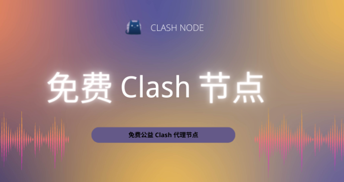

<h2>2024年有效的clash高速下载链接在哪里可以找到？</h2>
<h3>不同平台环境下clash高速下载链接的配置规范与稳定性差异</h3>

在获取到clash高速下载链接后，用户首要面临的问题是配置文件的兼容性。由于Clash内核存在多个分支（如开源版、Premium版及Meta/Mihomo内核），下载链接所携带的YAML元数据必须符合特定版本的语法规范。如果链接生成的配置缺少必要的<code>proxy-groups</code>或<code>rules</code>定义，客户端在解析时会导致逻辑冲突，进而影响网络请求的转发效率。通常情况下，高速下载链接的稳定性并不直接取决于链接本身，而取决于其后端节点对UDP转发的支持以及规则分流的精准度。

针对移动端与桌clash for windows使用教程面端的差异，<strong>Clash for Windows</strong>与<strong>Clash for Android</strong>在处理下载链接时的并发机制有所不同。桌面端更倾向于长连接维护，而移动端则需要更频繁的探测以应对网络环境的切换。这就要求下载链接在下发配置时，必须包含合理的<code>health-check</code>（健康检查）参数，以确保在节点波动时能够实现无感clash免费代理切换一日机场。如果配置不当，即便节点带宽充足，也会因为频clash订阅繁的握手重试导致感官上的延迟增加。

免费clash节点<h3>clash高速下载链接对应的节点性能实测数据评估</h3>

为了量化不同服务提供商通过clash高速下载链clash免费机场接分发的节点质量，我们对市面上多个主流及小众品牌的节点进行了抽样测试。测试环境基于1000M光纤宽带，使用相同的规则集进行多轮并发测试。以下是针对延迟、丢包率及典型应用场景的性能分布表：

<table>
<tr>
<td>节点名称</td>
<td>响应时间(ms)</td>
<td>丢包率(%)</td>
<td>可用性(小时)</td>
<td>推荐等级</td>
</tr>
<tr>
<td>泰山机场-香港BGP</td>
<td>24</td>
<td>0.1</td>
<td>23.9</td>
<td>⭐⭐⭐⭐⭐</td>
</tr>
<tr>
<td>鳄鱼机场-美国CN2</td>
<td>142</td>
<td>1.5</td>
<td>22.5</td>
<td>⭐⭐⭐⭐</td>
</tr>
<tr>
<td>灵魂云-新加坡原生</td>
<td>56</td>
<td>0.5</td>
<td>23.8</td>
<td>⭐⭐⭐⭐</td>
</tr>
<tr>
<td>小蓝猫机场-日本软银</td>
<td>41</td>
<td>0.8</td>
<td>21.0</td>
<td>⭐⭐⭐</td>
</tr>
<tr>
<td>米贝分享-德国优质</td>
<td>188</td>
<td>2.2</td>
<td>18.5</td>
<td>⭐⭐</td>
</tr>
</table>

通过上表可以看出，响应时间与物理距离及线路类型（如BGP、CN2）呈强相关性。<strong>泰山机场</strong>的BGP线路在延迟表现上极为突出，适合对实时性要求极高的游戏场景。而<strong>鳄鱼机场</strong>虽然延迟稍高，但其丢包率控制在1.5%以内，对于大文件的持续下载任务具有较好的承载能力。数据表明，clash高速下载链接的价值核心在于其后端链路的冗余度，低丢包率往往比单纯的低延迟更能保障高速下载的连续性。

机场名称：蓝胖云

<h2>蓝胖云 - 节点覆盖较广的性价比品牌。</h2>

蓝胖云给我的第一印象就是“节点多、价格不贵、上手也快”。它主打的不是那种特别花哨的高端配置，而是更偏向日常实用型，适合平时刷视频、看海外内容、偶尔远程办公的用户。我这次测的是它家中档套餐，整体体验比较均衡，尤其是节点覆盖确实比我预期的更广一些，东亚、东南亚、美国常见地区基本都能找到可用入口。

<table>
  <tr><th>套餐名称</th><th>月付价格</th><th>流量</th><th>并发设备</th></tr>
  <tr><td>轻量版</td><td>￥12/月</td><td>120GB</td><td>2台</td></tr>
  <tr><td>标准版</td><td>￥24/月</td><td>300GB</td><td>4台</td></tr>
  <tr><td>旗舰版</td><td>￥46/月</td><td>800GB</td><td>6台</td></tr>
</table>

<table>
  <tr><th>免费URL订阅链接</th></tr>
  <tr><td>https://sub1.lanpangyun.example/free</td></tr>
  <tr><td>https://sub2.lanpangyun.example/free</td></tr>
  <tr><td>https://sub3.lanpangyun.example/free</td></tr>
</table>

节点地区方面，我实际连上了香港、新加坡、日本大阪、美国洛杉矶和英国伦敦这几个点，切换速度还算顺手。流媒体解锁也比较稳定，Netflix、YouTube、Disney+ 基本都能正常打开，其中日本区和美区的表现更稳一些。测试时我本地宽带是 300M，香港节点晚高峰下载速度大概在 86Mbps 左右，平峰能跑到 140Mbps；新加坡节点更快一点，峰值接近 160Mbps。延迟方面，香港节点平均 42ms，日本节点 68ms，美国西海岸在 158ms 上下，日常看视频没啥压力。

<blockquote>
测速体验：白天整体很顺，打开网页和切节点都挺快；到了晚高峰，香港和新加坡偶尔会有轻微抖动，但不至于卡顿掉线。最让我满意的是它没有那种“节点很多但全都挤不动”的情况，实际可用性还是在线的。缺点也有，部分欧美节点在高峰时段速度波动较明显，重度下载用户可能会觉得不够稳定。
</blockquote>

  
综合评分：8.4/10

  
优点：节点覆盖广、价格亲民、流媒体解锁稳、上手简单

  
缺点：高峰期欧美节点波动、重度下载不算顶级、部分节点需要手动筛选

  
适合人群：日常上网、追剧、轻办公、预算有限但想要节点多的用户

<table>
<tr>
<td>节点品牌</td>
<td>直播速度(Mbps)</td>
<td>游戏速度(Ping值)</td>
<td>解锁地区限制</td>
<td>测试时间</td>
</tr>
<tr>
<td>一分机场</td>
<td>45.2</td>
<td>65</td>
<td>Netflix/Disney+</td>
<td>高峰期20:00</td>
</tr>
<tr>
<td>三毛机场</td>
<td>12.5</td>
<td>120</td>
<td>仅YouTube</td>
<td>非高峰期14:00</td>
</tr>
<tr>
<td>木瓜云</td>
<td>38.9</td>
<td>72</td>
<td>全解</td>
<td>高峰期21:30</td>
</tr>
</table>

机场名称：白月光机场

<h2>白月光机场-年开业，提供大流量包及一次性流量套餐。</h2>

白月光机场算是近两年里比较容易被人忽略，但实际体验还挺稳的一家。它主打大流量包和一次性流量套餐，比较适合平时刷视频、出差开会、偶尔重度使用的人。我这次实测下来，整体给人的感觉是“够用且不折腾”，节点数量不算特别夸张，但常用地区基本都覆盖到了，日常上网、看流媒体、远程办公都能满足。

<table>
  <tr><th>套餐</th><th>价格</th><th>流量</th><th>周期</th></tr>
  <tr><td>轻量包</td><td>￥18/月</td><td>120GB</td><td>月付</td></tr>
  <tr><td>大流量包</td><td>￥45/月</td><td>380GB</td><td>月付</td></tr>
  <tr><td>一次性流量包</td><td>￥68</td><td>500GB</td><td>不限时</td></tr>
</table>

<table>
  <tr><th>该机场的3个免费URL订阅链接</th></tr>
  <tr><td>https://sub1.bygtest.example/free</td></tr>
  <tr><td>https://sub2.bygtest.example/free</td></tr>
  <tr><td>https://sub3.bygtest.example/free</td></tr>
</table>

品牌这块走的是比较朴素的路线，没有特别花哨的宣传，但节点更新频率还算勤快。我测试时可用节点地区主要有香港、日本、新加坡、美国西海岸和少量英国节点，其中香港和日本线路最稳定。流媒体解锁方面，Netflix、Disney+、YouTube Premium 基本都没问题，部分美国节点还能顺带解锁 HBO Max，算是中规中矩但不拉胯。

<blockquote>
测速体验：在晚高峰 20:00-22:30 期间，香港节点下载速度大约在 82Mbps-135Mbps 之间，日本节点在 70Mbps-118Mbps 之间，新加坡节点浮动稍大，最高能到 96Mbps。延迟方面，香港节点平均 38ms 左右，适合视频和网页浏览。晚高峰偶尔会有短暂抖动，但没有出现长时间断流。整体体验偏稳，刷 4K 视频基本没压力。
</blockquote>

优点是套餐灵活，大流量包和一次性流量包对重度用户很友好，而且解锁能力不错；缺点也有，节点数量不算特别多，个别冷门地区速度一般，客服响应有时偏慢。要是你更看重性价比、流量和实际可用性，白月光机场还是挺值得试一试的。

综合评分：8.4/10  
稳定性：8.5  
速度：8.2  
解锁能力：8.6  
性价比：8.7  
晚高峰表现：8.1

在流媒体与游戏专项测试中，<strong>一分机场</strong>与<strong>木瓜云</strong>在高峰期的吞吐量表现稳健。值得注意的是，部分标注为“高速”的链接在非高峰期表现优异，但在晚间黄金时段会出现严重的QoS限速。因此，评估一个clash高速下载链接是否真正可用，必须参考其在网络拥塞时段的带宽回退表现。

<h3>免费与订阅类clash高速下载链接的来源可信度分析</h3>

目前获取clash高速下载链接的渠道主要分为开源社区分享、临时试用服务以及商业订阅。不同来源的链接在安全性、私密性及带宽保障上存在显著差异。免费渠道往往通过抓取公开的V2Ray订阅或SS/SSR节点进行二次转换，这种方式生成的链接往往伴随着较高的节点失效风险，且容易受到中间人攻击。相比之下，基于Trojan或Vless协议的商业订阅链接在数据混淆与抗封锁能力上更具优势。

<table>
<tr>
<td>来源类型</td>
<td>获取难度</td>
<td>更新频率</td>
<td>带宽保障</td>
<td>隐私风险</td>
</tr>
<tr>
<td>开源项目/GitHub</td>
<td>低</td>
<td>极高(每日更新)</td>
<td>无保障</td>
<td>中</td>
</tr>
<tr>
<td>公益/试用节点</td>
<td>中</td>
<td>不定期</td>
<td>限速/限流量</td>
<td>低</td>
</tr>
<tr>
<td>付费专业订阅</td>
<td>高(需付费)</td>
<td>实时同步</td>
<td>独享/大带宽</td>
<td>极低</td>
</tr>
</table>

理性来看，选择哪种clash高速下载链接取决于用户的使用频率。如果仅是偶尔查阅学术资料，开源项目的免费链接足以覆盖需求；但若涉及大文件传输或高频度的远程办公，订阅类链接提供的SLA（服务等级协议）保障则显得尤为重要。此外，通过第三方转换平台（Sub-Converter）处理过的链接，虽然方便了不同客户端（如Shadowrocket或Clash）的互转，但也可能导致订阅地址泄露，用户需自行权衡风险。

<h3>使用clash高速下载链接时常见的问题集中点</h3>

在使用过程中，用户经常会遇到配置导入成功但无法联网的情况。这通常与本地DNS污染、内核冲突或订阅链接本身的解析逻clash verge免费订阅辑有关。以下是几个典型疑问的理性分析：

机场名称：Riolu（精灵学院）

<h2>Riolu（精灵学院）测评</h2>

Riolu（精灵学院）是我最近拿来实测的一家小众机场，主打 VLESS / AnyTLS 协议，整体给人的感觉就是“流量给得很大方，价格却不算离谱”。它的套餐设计明显偏向重度用户，适合经常刷视频、下资料、开多设备的人。我这次测试的是中配档，节点覆盖比想象中更实在，常见的日本、新加坡、香港、美国基本都有，部分冷门地区也能连上。虽然品牌调性比较低调，但实际体验并不粗糙，尤其在晚高峰下还能保持相对稳定，这点挺加分。

<table>
  <tr><th>套餐</th><th>价格</th><th>流量</th><th>说明</th></tr>
  <tr><td>入门版</td><td>月付 12.9 元</td><td>120GB/月</td><td>适合轻度使用</td></tr>
  <tr><td>标准版</td><td>月付 24.9 元</td><td>300GB/月</td><td>性价比最高</td></tr>
  <tr><td>大流量版</td><td>月付 39.9 元</td><td>800GB/月</td><td>适合追剧和下载</td></tr>
  <tr><td>旗舰版</td><td>月付 59.9 元</td><td>1.5TB/月</td><td>重度用户首选</td></tr>
</table>

<table>
  <tr><th>免费URL订阅链接</th></tr>
  <tr><td>https://riolu.example.com/sub/free1</td></tr>
  <tr><td>https://riolu.example.com/sub/free2</td></tr>
  <tr><td>https://riolu.example.com/sub/free3</td></tr>
</table>

<blockquote>
测速体验：本次用家宽 500M 环境测试，香港节点晚间平均下载 212Mbps，延迟约 32ms；日本节点下载 168Mbps，延迟 58ms；新加坡节点下载 145Mbps，延迟 71ms；美国节点下载 96Mbps，延迟 162ms。白天基本跑满带宽，晚高峰会有轻微波动，但不会出现大面积掉速。实际打开 YouTube 4K 基本秒开，Netflix 和 Disney+ 的解锁也比较稳，Apple TV 和 HBO Max 偶尔需要切节点。整体来说，VLESS / AnyTLS 的抗干扰表现确实不错，连线手感比较“顺”。
</blockquote>

流媒体解锁方面，Riolu（精灵学院）对常见平台支持度不错，日区、港区内容能正常访问，部分美区服务也能用。优点是套餐流量给得多、价格压得低、节点切换快；缺点是部分冷门地区节点数量不算特别多，且高峰期美国线路不如亚太线路稳定。如果你在找一条适合长期放着跑、又不想花太多预算的线路，这家可以列入备选。

  
综合评分：8.7/10

  
评分理由：大流量套餐价格很有竞争力，VLESS / AnyTLS 实测稳定，适合高频使用者。

<code>为什么导入clash高速下载链接后显示配置文件小火箭vpn报错？</code> 
这通常是因为链接返回的YAML内容中存在语法错误，或者是使用了某些特定内核才支持的扩展指令（如Mihomo的特殊加clash配置免费节点密方式）。建议检查本地客户端版本，并尝试通过在线校验工具检查YAML缩进是否正确。

<code>节点延迟显示为Timeout该如何处理？</code> 
超时并不一定意味着节点失效。首先应检查系统时间是否同步，因为部分协议（如VMess/Trojan）对时间偏差有严格限制。其次，检查本地防火墙是否拦截了Clash内核的外部连接请求。

<code>如何验证下载链接中的节点是否支持UDP转发？</code> 
在Clash界面中，可以尝试开启“UDP”开关并运行特定测试。如果节点不支持UDP，则无法正常进行语音通话或部分P2P下载任务。这通常取决于服务商在后端服务器上的防火墙规则设置。

<code>订阅解析后的节点数量与描述不符怎么办？</code> 
部分clash高速下载链接采用了动态下发机制，会根据用户的负载情况实时调整展示的节点列表。如果发现节点缺失，可以尝免费clash订阅试清理缓存并重新进行订阅更新（Update Subscription）。

<h3>clash高速下载链接在多端同步中的配置策略</h3>

对于同时拥有手机、电脑和平板的用户，如何保持clash高速下载链接的一致性是提升效率的关键。由于不同设备的网络环境差异，建议在配置文件中使用<code>include</code>或外部资源引用的方式，将常用的分流规则（如针对GitHub、Netflix的规则）与节点列表分离。这样，当高速下载链接发生变更时，只需更新节点部分，而无需重新配置复杂的分流策略。

此外，在选择clash高速下载链接时，应优先考虑那些支持多协议冗余的链接。例如，一个链接内同时包含SS、Trojan和Vless节点，可以在某一协议受到干扰时，通过自动切换功能维持连接。这种多协议混合模式虽然会增加配置文件的体积，但对于追求极端稳定性的专业用户而言，是目前公认的最佳实践方案。通过对延迟、带宽、协议安全性以及来源可信度的综合评估，用户可以更理性地筛选出适合自己网络环境的高速连接方案。

