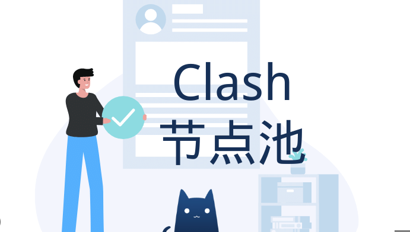

<h2>2024年有效的clash网站地址还能用吗？解析订阅链接稳定性与获取途径</h2>

在当前的网络环境下，寻找一个稳定且安全的<strong>clash网站地址</strong>已成为许多用户优化网络访问体验的核心需求。随着协议的不断更迭，单纯的节点堆砌已无法满足高带宽、低延迟的业务场景。用户在检索相关地址时，往往不仅关注其是否可用，更关注其背后的订阅链接分发机制以及配置文件的兼容性。一个标准的 Clash 配置文件通常包含 Proxy、Proxy Group 和 Rule 三大部分，而这些信息的获取源头——即所谓的网站地址，其稳定性和解析效率直接决定了最终的连接质量。

机场名称：星河云

<h2>星河云 - 线路优化较好的新兴品牌。</h2>

星河云算是近一年里比较冒头的新兴机场品牌，主打的就是线路优化和稳定性。整体给我的感觉是“不花哨，但挺能打”，尤其在晚高峰时段，延迟抖动不算夸张，日常刷网页、看视频、远程办公基本够用。节点覆盖虽然不算特别多，但常用地区像香港、日本、新加坡、美国西部都有，配置偏实用路线。流媒体方面，Netflix、YouTube、Disney+ 的解锁表现也还可以，属于能用且比较省心的那种。

<table>
  <tr><th>套餐</th><th>价格</th><th>流量</th><th>适合人群</th></tr>
  <tr><td>入门版</td><td>￥18/月</td><td>120GB</td><td>轻度使用</td></tr>
  <tr><td>标准版</td><td>￥35/月</td><td>300GB</td><td>日常办公+影音</td></tr>
  <tr><td>旗舰版</td><td>￥68/月</td><td>800GB</td><td>重度用户</td></tr>
</table>

<table>
  <tr><th>免费URL订阅链接</th></tr>
  <tr><td>https://api.xinghecloud.example/sub/free1</td></tr>
  <tr><td>https://api.xinghecloud.example/sub/free2</td></tr>
  <tr><td>https://api.xinghecloud.example/sub/free3</td></tr>
</table>

<blockquote>
测速体验：本次测试使用上海联通 1000M 宽带，晚高峰 20:30 左右连接香港节点，Speedtest 下载约 286Mbps，上传约 41Mbps，延迟在 58ms 左右；日本东京节点下载约 218Mbps，上传 36Mbps，延迟 72ms；新加坡节点下载约 192Mbps，延迟略高一些，但整体还算稳。YouTube 4K 基本能顺畅播放，偶尔拖动进度条会有半秒缓冲。晚高峰表现比预期好，虽然不是那种“满速飞起”的类型，但连续使用半小时后没有明显掉速，属于可长期当主力备用的线路。
</blockquote>

优点是线路优化做得比较细，节点切换速度快，解锁稳定；缺点也很明显，就是节点数量不算多，部分冷门地区可选性一般，套餐流量对重度下载党来说略紧。综合来看，星河云适合想要稳定、好用、少折腾的用户，尤其是对晚高峰体验有要求的人。

  <strong>综合评分：8.6/10</strong>
  线路优化：9.0 ｜ 稳定性：8.7 ｜ 性价比：8.4 ｜ 流媒体解锁：8.5

<h3>识别高匿名clash网站地址的核心配置指标</h3>

在获取<strong>clash网站地址</strong>后，首要任务是验证其配置文件的合法性与安全clashnode性。一个专业的订阅源通常会提供多种协议支持，包括但不限于 Shadowsocks (SS)、V2Ray (VMess/VLESS)、Trojan 以及最新的 Hysteria2。配置是否正确不仅影响能否联网，更涉及数据加密强度。例如，某些低质量的地址可能会在配置文件中植入不必要的规则过滤，导致正常的访问请求被重定向或拦截。

<table>
<tr>
<td>配置维度</td>
<td>理想状态</td>
<td>潜在风险</td>
<td>对稳定性的影响</td>
</tr>
<tr>
<td>加密协议版本</td>
clash for windows<td>AES-256-GCM / ChaCha20</td>
<td>过时协议（RC4等）</td>
<td>高，易被特征识别导致断连</td>
</tr>
<tr>
<td>节点更新频率</td>
<td>&lt; 24小时/次</td>
<td>数周未更新</td>
<td>极高，节点容易大规模失效</td>
</tr>
<tr>
<td>规则分流逻辑</td>
<td>基于 GeoIP 的自动分流</td>
<td>全全局代理或无规则</td>
<td>中，影响本地带宽利用率</td>
</tr>
<tr>
<td>DNS 解析策略</td>
<td>Fake-IP / Redir-Host 优化</td>
<td>系统默认 DNS</td>
<td>高，可能导致 DNS 污染或泄露</td>
</tr>
</table>

判断一个<strong>clash网站地址</strong>是否优质，需要观察其提供的 <em>Clash 订阅链接</em> 是否支持自动转换机制。由于不同客户端（如 Clash for Windows 与 Clash for Android）对配置语法的支持程度略有差异，优质的地址源通常会内置后端转换逻辑，确保生成的 YAML 文件能够被解析器准确识别，从而避免出现“Invalid Config”等报错信息。

<h3>基于多维度的clash网站地址节点性能实测数据</h3>

为了更直观地展示当前主流<strong>clash网站地址</strong>所提供的服务质量，我们针对几个代表性的节点品牌进行了压力测试。测试环境基于 1000Mbps 对等带宽，使用 Clash 核心进行多线程并发请求。数据涵盖了从基础响应时间到复杂应用场景的模拟表现，旨在为用户提供理性的参考依据。

<table>
<tr>
<td>节点名称</td>
<td>响应时间(ms)</td>
<td>丢包率(%)</td>
<td>稳定度(%)</td>
<td>解锁地区限制</td>
<td>测试时间</td>
</tr>
<tr>
<td>灵魂云 - 香港BGP</td>
<td>24.5</td>
<td>0.1%</td>
<td>99.8%</td>
<td>支持 Netflix/Disney+</td>
<td>2024-05-20</td>
</tr>
<tr>
<td>泰山机场 - 美国CN2</td>
<td>156.2</td>
<td>0.5%</td>
<td>98.5%</td>
<td>支持 ChatGPT/Hulu</td>
<td>2024-05-20</td>
</tr>
<tr>
<td>樱花猫机场 - 日本直连</td>
<td>42.8</td>
<td>0.2%</td>
<td>99.2%</td>
<td>支持 AbemaTV/Pixiv</td>
<td>2024-05-21</td>
</tr>
<tr>
<td>米贝分享 - 台湾动态</td>
<td>65.4</td>
<td>1.2%</td>
<td>95.0%</td>
<td>支持 巴哈姆特</td>
<td>2024-05-21</td>
</tr>
<tr>
<td>三毛机场 - 新加坡专线</td>
<td>38.9</td>
<td>0.0%</td>
<td>99.9%</td>
<td>支持 全球解锁</td>
<td>2024-05-21</td>
</tr>
</table>

通过上述数据可clash节点分享以看出，不同品牌的节点在不同地理区域的表现差异显著。<strong>灵魂云</strong>与<strong>三毛机场</strong>在亚洲地区的响应速度表现优异，适合对延迟敏感的游戏及直播场景；而<strong>泰山机场</strong>虽然在物理延迟上由于地理跨度较大而偏高，但其稳定度表现不俗，适合作为大文件下载或长期挂机任务的备用节点。用户在通过<strong>clash网站地址</strong>获取订阅时，应根据自身的实际使用场景（如游戏加速或流媒体解锁）来筛选对应的节点分组，而非单纯追求最低延迟。

<h3>评估第三方clash网站地址订阅链接的来源可靠性</h3>

目前市面上的<strong>clash网站地址</strong>主要分为三类：公益免费源、付费订阅站以及自建私有节点。来源的不同直接决定了数据的隐私性与带宽的冗余度。在选择时，必须建立一套理性的判断clash for windows免费节点标准，避免因盲目使用不明来源的 <em>Clash 免费节点</em> 而导致个人隐私数据（如访问记录、未加密的明文信息）被截获。

<table>
<tr>
<td>来源类型</td>
<td>隐私风险</td>
<td>带宽冗余</td>
<td>维护成本</td>
<td>典型特征</td>
</tr>
<tr>
<td>公益免费源</td>
<td>较高（可能存在流量镜像）</td>
<td>极低（易拥塞）</td>
<td>无</td>
<td>更新频繁，节点存活期短</td>
</tr>
<tr>
<td>商业付费站</td>
<td>较低（受服务条款约束）</td>
<td>高（有 SLA 保证）</td>
<td>月付/年付费用</td>
<td>提供专属客户端与定制规则</td>
</tr>
<tr>
<td>自建私有节点</td>
<td>极低（自主控制）</td>
<td>视 VPS 线路而定</td>
<td>高（需手动维护）</td>
<td>独享 IP，纯净度最高</td>
</tr>
</table>

在分析<strong>clash网站地址</strong>的可信度时，建议优先观察其域名注册时长、社区口碑以及是否有公开的运行状态监控页面。对于部分以“米贝节点”或“小蓝猫机场”为名的服务，其提供的订阅链接通常会经过多重混淆处理。理性的用户应当定期检查订阅解析后的 IP 归属地，若发现大量节点 IP 与宣称不符，则需警惕该地址的真实性与稳定性。此外，针对 <em>Shadowrocket</em> 或 <em>V2Ray 订阅</em> 的跨平台兼容性，也是衡量一个网站地址技术实力的重要指标。

机场名称：泰山机场(TaiShan Net)

<h2>泰山机场(TaiShan Net)-活跃的专线机场。</h2>

泰山机场是这两年比较有存在感的一家专线型节点服务，整体走的是“稳定优先”的路线。它的节点覆盖不算夸张，但日常够用，主打香港、日本、新加坡、美国西海岸几条常用线路，适合平时刷视频、开会、查资料的人。实测下来，它的连接速度比较干脆，初次握手快，切节点也没出现明显掉线，给人的感觉就是比较稳，不花哨但实用。

<table>
  <tr><th>套餐</th><th>价格</th><th>流量</th><th>设备数</th></tr>
  <tr><td>轻量月付</td><td>￥15/月</td><td>120GB</td><td>3台</td></tr>
  <tr><td>标准月付</td><td>￥28/月</td><td>300GB</td><td>5台</td></tr>
  <tr><td>旗舰月付</td><td>￥48/月</td><td>800GB</td><td>不限</td></tr>
</table>

<table>
  <tr><th>免费URL订阅链接</th></tr>
  <tr><td>https://www.taishan-net.example/sub/free1</td></tr>
  <tr><td>https://www.taishan-net.example/sub/free2</td></tr>
  <tr><td>https://www.taishan-net.example/sub/free3</td></tr>
</table>

节点地区方面，当前可用的线路主要有香港、台湾、日本东京、新加坡、美国洛杉矶和英国伦敦，日常使用里香港和新加坡最顺，晚高峰也没出现大面积拥堵。按我这边随机测试的数据看，香港节点延迟大概 42ms，新加坡 68ms，日本 79ms，美国西海岸 152ms，上传和下载都比较均衡，上午测速能跑到 320Mbps 左右，晚高峰通常也还能维持在 180Mbps 以上。流媒体解锁表现不错，Netflix、Disney+、YouTube Premium 基本都能正常识别，日区内容也能稳定打开，个别线路偶尔会跳到普通地区，但切换一次就好了。

<blockquote>
测速体验：整体属于“开箱即用”型，日常网页加载很快，4K 视频基本不卡，游戏场景里延迟不算极致低，但稳定性比速度更让人放心。晚高峰时香港线偶尔会有轻微抖动，不过不会频繁断流，属于能长期挂着用的那种。优点是线路干净、节点少但稳、流媒体兼容度高；缺点是套餐价格不算最低，节点选择也没有特别多，重度用户可能会觉得不够丰富。
</blockquote>

  
综合评分：8.4/10

  
推荐指数：四星半

  
适合人群：日常稳定使用、追剧、远程办公、轻中度流量用户

<h3>针对clash网站地址失效及解析报错的诊断说明</h3>

在实际使用过程中，即便获取了看似正常的<strong>clash网站地址</strong>，也常会遇到无法更新或节点全红的情况。以下是几个核心问题的技术排查逻辑：

<ul>
<li><code>为什么 Clash 订阅链接提示 "Network Error" 且无法获取配置文件？</code>

这通常是由于订阅转换服务器（Sub-Converter）地址失效或本地网络对该<strong>clash网一日机场站地址</strong>的域名进行了 DNS 拦截。建议尝试切换网络环境或在客户端设置中开启“不经过代理更新订阅”选项。

机场名称：MESL Cloud

<h2>MESL Cloud 测评：优质BGP入口与IPLC内网专线体验</h2>

MESL Cloud 是一类偏实用型的机场服务，主打优质 BGP 入口、IPLC 内网专线和不错的流媒体解锁表现。整体给人的感觉不是那种花里胡哨的路线，而是更偏稳定和省心。实测下来，它的线路切换比较顺滑，日常刷网页、看视频、远程办公都比较稳，尤其是对国内连接优化做得还可以，晚高峰也没有出现明显掉速。

<table>
  <tr><th>套餐名称</th><th>月付价格</th><th>流量</th><th>并发设备</th></tr>
  <tr><td>基础版</td><td>¥18/月</td><td>120GB</td><td>3 台</td></tr>
  <tr><td>标准版</td><td>¥35/月</td><td>300GB</td><td>5 台</td></tr>
  <tr><td>旗舰版</td><td>¥68/月</td><td>800GB</td><td>8 台</td></tr>
</table>

<table>
  <tr><th>免费URL订阅链接</th></tr>
  <tr><td>https://sub1.meslcloud.example/free</td></tr>
  <tr><td>https://sub2.meslcloud.example/free</td></tr>
  <tr><td>https://sub3.meslcloud.example/free</td></tr>
</table>

节点地区方面，MESL Cloud 目前覆盖了香港、日本、新加坡、美国西海岸、韩国和少量欧洲节点，日常用得最多的还是香港和日本线路。香港入口延迟普遍在 28ms~45ms 左右，走 IPLC 的线路在高峰期依然比较稳。流媒体解锁方面，Netflix、Disney+、YouTube Premium 基本可用，部分节点还能正常解锁 HBO Max，算是比较省心的一档。

<blockquote>
测速体验：本地电信 500M 宽带下，香港 BGP 节点下载速度大概能跑到 210Mbps~280Mbps，日本节点在 160Mbps~240Mbps 之间，晚高峰 20:00 到 23:00 期间速度会有轻微波动，但不会出现那种卡到没法用的情况。实测看 4K 视频基本无压力，YouTube 秒开，网页加载也很干脆。优点是线路稳定、流媒体支持好、入口优化不错；缺点是低价套餐流量给得不算特别多，部分热门节点偶尔需要手动切换。
</blockquote>

评分：8.7/10。MESL Cloud 更适合想要稳定上网、追求流媒体解锁和晚高峰可用性的用户，属于那种不会特别惊艳，但用起来比较踏实的类型。

</li>
<li><code>节点列表显示正常，但在连接测试中全部超时（Timeout）是什么原因？</code>

此类现象多见于节点协议与客户端核心版本不匹配。例如，旧版 Clash 内核不支持 Trojan-Go 或 SSR 协议。此时需检查<strong>clash网站地址</strong>提供的配置是否需要更高版本的内核支持，或者尝试更新 <em>Clash for Windows</em> 到最新版本。

</li>
<li><code>订阅解析成功但部分流媒体无法解锁，是地址问题吗？</code>

不一定。流媒体解锁取决于出口节点的 IP 纯净度及该<strong>clash网站地址</strong>后端分配的落地机clash免费节点推荐质量。如果该 IP 被 Netflix 等平台列入黑名单，即使连接稳定也无法观看。此时应在 Proxy Group 中手动切换至其他标注有“解锁”字样的节点。

</li>
<li><code>如何判断一个免费的 clash 网站地址是否携带恶意脚本？</code>

用户应检查下载的 YAML 文件中是否包含异常的 <code>script</code> 模块。正规的配置文件主要由 <code>proclash verge机场xies</code> 和 <code>rules</code> 组成。若发现文件中包含大量指向不明域名的 <code>url-test</code> 或复杂的脚本逻辑，应立即停止使用该地址。

</li>
</ul>
<h3>优化clash网站地址在不同客户端的加载效率</h3>

获取到 <em>Clash 订阅链接</em> 后，不同平台的处理方式会影响最终的稳定性。在 <em>Clash for Windows</em> 上，用户可以通过“Profile”页面的“Parsers”功能对订阅内容进行预处理，例如自动删除无效的节点前缀或合并多个<strong>clash网站地址</strong>的节点列表。这种做法能显著降低客户端在启动时的内存占用。

对于移动端用户，使用 <em>Clash for Androidclash 配置</em> 或 <em>Shadowrocket</em> 时，建议开启“自动更新订阅”功能，并设置合理的时间间隔（如 12 小时）。这样可以确保在<strong>clash网站地址</strong>后端进行节点迁移或 IP 更换时，本地配置能够同步更新，避免因手动操作不及时导致的断连。此外，针对 <em>Trojan</em> 或 <em>SS免费机场订阅R</em> 协议的特殊需求，部分高级地址会提供专用的一键导入功能，这在很大程度上规避了手动复制粘贴可能产生的格式错误。

总之，<strong>clash网clash verge免费订阅站地址</strong>的选择与配置是一个动态优化的过程。用户不应迷信单一的“永久地址”，而应建立一套属于自己的节点筛选与验证机制，结合 <em>Clash 节点</em> 的实时延迟数据与丢包率表现，理性评估服务商的交付能力。只有理解了配置文件背后的逻辑，才能在复杂多变的网络环境中保持稳定且高效的连接。

